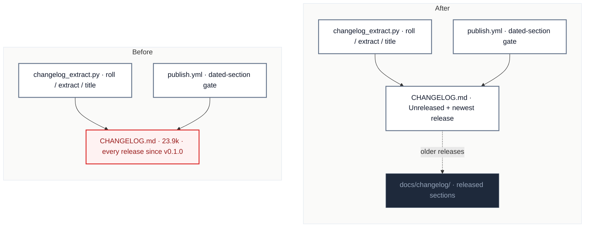

# C1 · `CHANGELOG.md` keeps the open release; released ones move out

[← Report](README.md)

🟢 **Strong** · `in-process` · builds on: —

`CHANGELOG.md:1-344` · `scripts/changelog_extract.py:27-97` · `scripts/prepare_release.sh:86-93` · `.github/workflows/publish.yml:46-49,133-134` · `docs/releasing.md`

94 commits in 3 months touch `CHANGELOG.md` (23,948 tokens). `[Unreleased]` + v0.7.0 is ~3,700 tokens. v0.6.0 alone is ~17,400 (lines 62–208), so no single file can hold it.

| Problem | Solution | Wins |
|---|---|---|
| Every user-visible PR edits a 24k-token file that the budget check will refuse. | Keep `[Unreleased]` and the newest release in `CHANGELOG.md`, and move released sections out under `docs/changelog/`. The release tooling still rolls and extracts the release being cut. | locality: the open release, alone unblocks every PR's changelog entry |

- **Release tooling:** `roll` only touches `[Unreleased]` and the section above it. `extract` and `title` run on the version being released, which is always the newest. Check that this holds before changing the tooling.
- **v0.6.0 is a published dated record:** decide whether it is split or marked `linguist-generated` like the old arch-review reports.
- **Unaffected:** `MANIFEST.in` and `pyproject.toml` don't ship the file, no test reads it, and `README.md:165` links it.

Decisions

<!-- filled during implementation, one line each -->

