# C2 · Split `model/shape.py` and `model/task.py` along their seams

[← Report](README.md)

🟢 **Strong** · `in-process` · builds on: —

`src/pyxctsk/model/shape.py:1-729` · `src/pyxctsk/model/task.py:1-602` · `tests/model/test_shape.py:1-568` · `tests/test_layering.py` (`EXPECTED_DEFERRED_IMPORTS`)

```mermaid
flowchart LR
  subgraph before["Before"]
    direction TB
    S1["shape.py · 7.0k<br>JSON I/O · Codec · wire scalars · Field / Shape"]:::leak
    T1["task.py · 5.5k<br>Waypoint … Goal · Task"]:::leak
    TS1["test_shape.py · 5.4k<br>Toy machinery · every real table"]:::leak
  end
  subgraph after["After"]
    direction TB
    S2["shape.py · Field / Shape / shape_codec"]:::deep
    subgraph sh[" "]
      direction TB
      J2["JSON I/O and Codec"]:::faded
      W2["wire-scalar codecs"]:::faded
    end
    S2 -.- sh
    T2["task.py · Task + TASK_SHAPE"]:::deep
    subgraph tk[" "]
      direction TB
      PT2["turnpoints and takeoff"]:::faded
      SG2["SSS and goal"]:::faded
    end
    T2 -.- tk
    TS2["test_shape.py · the Toy machinery"]:::module
    WT2["conformance · every real table"]:::module
  end
  before ~~~ after
  classDef module fill:#ffffff,stroke:#64748b,stroke-width:2px,color:#0f172a
  classDef shallow fill:#f1f5f9,stroke:#94a3b8,stroke-dasharray:4 3,color:#334155
  classDef deep fill:#0f172a,stroke:#0f172a,color:#e2e8f0
  classDef faded fill:#1e293b,stroke:#475569,color:#94a3b8
  classDef leak fill:#fef2f2,stroke:#dc2626,stroke-width:2px,color:#991b1b
  style sh fill:#0f172a,stroke:#0f172a
  style tk fill:#0f172a,stroke:#0f172a
  style before fill:#fafaf9,stroke:#e2e8f0
  style after fill:#fafaf9,stroke:#e2e8f0
```

Both files are deep modules that grew past the budget. 13 files import from `model.shape`.

`shape.py` has three seams:

| Lines | Seam | Tokens |
|---|---|---|
| 1–213 | JSON I/O and `Codec` | ~1.8k |
| 214–428 | wire-scalar codecs | ~2.1k |
| 429–729 | `Field`/`Shape` | ~2.9k |

`task.py` has three seams:

| Lines | Seam | Tokens |
|---|---|---|
| 64–310 | points and takeoff | ~2.0k |
| 311–396 | goal | ~0.8k |
| 397–602 | `Task` | ~2.2k |

| Problem | Solution | Wins |
|---|---|---|
| The model's two most-read modules can't be committed to without first being split. | Move each internal seam into a sibling submodule of `model/`. `Shape` and `Task` keep their interface, and the model still imports nothing outside `model/`. | locality: codecs apart from traversal interface unchanged for 13 importers |

- **`EXPECTED_DEFERRED_IMPORTS`:** its entry is keyed `("model/task.py", "qrcode.conversion")`, so `Task.to_qr_code_task` stays in `task.py`.
- **AGENTS.md:** it names `model/shape.py` as the home of the codecs and of `load_json`/`dump_json`. Decide between re-exporting the names and updating AGENTS.md, and record the choice.
- **`tests/model/test_shape.py`:** lines 366–568 test every real table across `model` and `qrcode`. They are a conformance test, not a test of `shape.py`.

Decisions

<!-- filled during implementation, one line each -->

