# C2 · Split `model/shape.py` and `model/task.py` along their seams

[← Report](README.md)

🟢 **Strong** · `in-process` · builds on: —

`src/pyxctsk/model/shape.py:1-729` · `src/pyxctsk/model/task.py:1-602` · `tests/model/test_shape.py:1-568` · `tests/test_layering.py` (`EXPECTED_DEFERRED_IMPORTS`)

```mermaid
flowchart LR
  subgraph before["Before"]
    direction TB
    S1["shape.py · 7.0k<br>JSON I/O · Codec · wire scalars · Field / Shape"]:::leak
    T1["task.py · 5.5k<br>Waypoint … Goal · Task"]:::leak
    TS1["test_shape.py · 5.4k<br>Toy machinery · every real table"]:::leak
  end
  subgraph after["After"]
    direction TB
    S2["shape.py · Field / Shape / shape_codec"]:::deep
    subgraph sh[" "]
      direction TB
      J2["JSON I/O and Codec"]:::faded
      W2["wire-scalar codecs"]:::faded
    end
    S2 -.- sh
    T2["task.py · Task + TASK_SHAPE"]:::deep
    subgraph tk[" "]
      direction TB
      PT2["turnpoints, takeoff and SSS"]:::faded
      SG2["goal"]:::faded
    end
    T2 -.- tk
    TS2["test_shape.py · the Toy machinery"]:::module
    WT2["conformance · every real table"]:::module
  end
  before ~~~ after
  classDef module fill:#ffffff,stroke:#64748b,stroke-width:2px,color:#0f172a
  classDef shallow fill:#f1f5f9,stroke:#94a3b8,stroke-dasharray:4 3,color:#334155
  classDef deep fill:#0f172a,stroke:#0f172a,color:#e2e8f0
  classDef faded fill:#1e293b,stroke:#475569,color:#94a3b8
  classDef leak fill:#fef2f2,stroke:#dc2626,stroke-width:2px,color:#991b1b
  style sh fill:#0f172a,stroke:#0f172a
  style tk fill:#0f172a,stroke:#0f172a
  style before fill:#fafaf9,stroke:#e2e8f0
  style after fill:#fafaf9,stroke:#e2e8f0
```

Both files are deep modules that grew past the budget. 9 files import from `model.shape`.

`shape.py` has three seams:

| Lines | Seam | Tokens |
|---|---|---|
| 1–213 | JSON I/O and `Codec` | ~2.0k |
| 214–428 | wire-scalar codecs | ~2.1k |
| 429–729 | `Field`/`Shape` | ~2.9k |

`task.py` has three seams:

| Lines | Seam | Tokens |
|---|---|---|
| 64–310 | points, takeoff and SSS | ~2.0k |
| 311–396 | goal | ~0.8k |
| 397–602 | `Task` | ~2.2k |

| Problem | Solution | Wins |
|---|---|---|
| The model's two most-read modules can't be committed to without first being split. | Move each internal seam into a sibling submodule of `model/`. `Shape` and `Task` keep their interface, and the model still imports nothing outside `model/`. | locality: codecs apart from traversal interface unchanged for 9 importers |

- **`EXPECTED_DEFERRED_IMPORTS`:** its entry is keyed `("model/task.py", "qrcode.conversion")`, so `Task.to_qr_code_task` stays in `task.py`.
- **AGENTS.md:** it names `model/shape.py` as the home of the codecs and of `load_json`/`dump_json`. Decide between re-exporting the names and updating AGENTS.md, and record the choice.
- **`tests/model/test_shape.py`:** lines 366–568 test every real table across `model` and `qrcode`. They are a conformance test, not a test of `shape.py`.

Decisions

<!-- filled during implementation, one line each -->

- Q1 — Which siblings does `shape.py` split into? → `model/json_io.py` (`JsonLayout`, `load_json`, `dump_json`, `require_object`) and `model/codec.py` (`Codec`, the wire-scalar codecs `NUMBER` … `TIME_OF_DAY`, `enum_codec`, `wire_int_codec`, `list_codec`, with the rules comment at `shape.py:214-238` as its docstring); `shape.py` keeps `Optionality` and its four instances, `Field`, `Value`, `Discriminator`, `Shape`, `shape_codec` and its docstring, because measured at bytes/4 that is `shape.py` ≈ 3.6k (622 docstring + 2,896 for lines 429–729), `codec.py` ≈ 2.8k (333 for 167–213 + 2,118 for 214–428) and `json_io.py` ≈ 0.9k (lines 75–166), and `parser.py`, `cli.py` and `renderer.py` import only `load_json`/`dump_json`, so JSON I/O has callers that never touch a codec.
- Q2 — Where do the helpers that cross the new seams go? → `_json_type` moves to `json_io.py` as `json_type` and `_read_at` to `codec.py` as `read_at`, neither re-exported by `model/__init__.py`; `_describe`, `_identity` and `_READ_ERRORS` stay private in `codec.py`, because `_json_type` is used at `shape.py:105` (JSON) and `:258`, `:422` (codecs) and `_read_at` at `:423` (`list_codec`) and `:670` (`Shape.read`), while the other three are used only inside lines 72–360.
- Q3 — Does `shape_codec` move with the codecs? → it stays in `shape.py`, because it is `Codec(shape.write, shape.read)` (`shape.py:729`) and needs `Shape`, so in `codec.py` it would import `shape.py` back and close a cycle.
- Q4 — Does `shape.py` re-export the moved names, or do callers and AGENTS.md change? → `shape.py` re-exports every moved public name (`JsonLayout`, `load_json`, `dump_json`, `require_object`, `Codec`, the seven wire-scalar codecs, `enum_codec`, `wire_int_codec`, `list_codec`) in a commented `# noqa: F401` block, the same pattern as `task.py`'s enum re-export (`task.py:23-34`); importers outside `model/` keep importing from `model.shape`, and inside `model/` the modules import from the module that defines each name, because the card's Wins promise "interface unchanged for 9 importers", AGENTS.md lines 47–48 send callers to `model/shape.py` for the codecs and `load_json`/`dump_json`, and one importer, `tests/qrcode/test_codec.py` (8,002 tokens), could not be edited under the `file-tokens` job.
- Q5 — Which siblings does `task.py` split into? → one, `model/task_parts.py`: `Waypoint`, `Turnpoint`, `Takeoff`, `SSS`, `Goal`, their five `*_SHAPE` tables and `_OBSOLETE` (lines 64–396); `task.py` keeps `Task` and `TASK_SHAPE` (397–602), because lines 64–396 measure 2,854 tokens (≈ 3.2k with imports, under 3,750), and `task.py` ≈ 2.6k, all five classes share one import set (`Shape`, `Value`, the codecs, the enums, `TimeOfDay`), and lines 64–396 mention `Task` only in docstrings, so a separate 0.8k `goal.py` would buy no locality.
- Q6 — How do the 22 files importing `model.task` keep working? → `task.py` re-exports `Waypoint`, `Turnpoint`, `Takeoff`, `SSS` and `Goal` in a `# noqa: F401` block like its enum re-export (`task.py:23-34`); the five moved `*_SHAPE` tables are not re-exported, because `pyxctsk/__init__.py:72` publishes the classes from `model.task`, while those five tables are imported only by `tests/model/test_shape.py:38-43`, which moves (`TASK_SHAPE`, imported by `parser.py:60`, stays put).
- Q7 — Where does `model/__init__.py` import the classes from? → from their defining modules (`.task_parts` and `.task`), not through `task.py`'s re-export, because the rule is that a package imports sibling submodules directly, and its current line is `from .task import SSS, Goal, Takeoff, Task, Turnpoint, Waypoint`.
- Q8 — Does `EXPECTED_DEFERRED_IMPORTS` stay valid? → yes, unchanged: `Task.to_qr_code_task` (`task.py:533`) and the `TYPE_CHECKING` import of `QRCodeTask` (`task.py:59-60`) stay in `task.py` and `task_parts.py` has no `qrcode` reference, so `("model/task.py", "qrcode.conversion")` still matches, and `tests/test_layering.py` (5,084 tokens) is not touched.
- Q9 — Do the new modules form a cycle inside `model/`? → no: `json_io` → `..exceptions`; `codec` → `json_io`, `rounding`, `time_of_day`, `..exceptions`; `shape` → `codec`, `json_io`, `passthrough`; `task_parts` → `shape`, `codec`, `enums`, `passthrough`, `time_of_day`; `task` → `task_parts`, `shape`, `codec`, `json_io`, `enums`, `validation`, because those are the names each seam uses today, and `validation.py` imports `task` only under `TYPE_CHECKING` (`validation.py:38`).
- Q10 — Where do the tests in `tests/model/test_shape.py` go? → lines 366–568 (`ALL_SHAPES`, the wire-type, key-ownership and table-vs-model checks, `_MINIMAL`) go to `tests/conformance/test_field_tables.py`, `TestWireScalars` and `TestCodecs` (181–310) to `tests/model/test_codec.py`, and `test_shape.py` keeps the `Toy` machinery (1–180, 311–365), because those measure ≈ 2.0k, ≈ 1.4k and ≈ 2.0k plus imports, `tests/` mirrors `src/pyxctsk/`, and "field table" is the glossary's term (`GLOSSARY.md:135`) for what the moved tests check.
- Q11 — Does C2 need to be reordered after C4? → no, C2 keeps its place before C4, because with Q4's re-export `tests/qrcode/test_codec.py:802` (`from pyxctsk.model.shape import NUMBER, OPTIONAL, Value`) still resolves and stays untouched, as does `tests/test_layering.py` (5,084, Q8), so every file the Build touches is listed in Q12 and comes out under 5,000 tokens.
- Q12 — Which files does the Build touch, and which docs change? → edited: `model/shape.py` (6,969 → ≈ 3.8k), `model/task.py` (5,507 → ≈ 2.7k), `tests/model/test_shape.py` (5,383 → ≈ 2.4k), `model/__init__.py` (398, imports and docstring naming the new modules), AGENTS.md (2,683; line 47 also says the codecs are defined in `model/codec.py`, and line 56 names `model/task_parts.py` beside `model/task.py`, since the dataclasses are no longer defined only there) and `tests/qrcode/test_conversion.py` (3,871; line 246 now points at `conformance/test_field_tables.py`); created: `model/json_io.py` ≈ 0.9k, `model/codec.py` ≈ 2.8k, `model/task_parts.py` ≈ 3.2k, `tests/model/test_codec.py` ≈ 1.6k, `tests/conformance/test_field_tables.py` ≈ 2.2k; `task.py`'s docstring narrows to `Task`; AGENTS.md line 48, README.md:29, GLOSSARY.md, CHANGELOG.md and `qrcode/conversion.py:10` stay as they are, because `model.shape.load_json`/`dump_json`/`wire_int_codec` still resolve through Q4's re-export, README links `model/task.py` for `Task.validate`, which stays there, GLOSSARY.md names no file, and no exported name moves.

