# C3 · Split the CLI and layering tests

[← Report](README.md)

🟢 **Strong** · `in-process` · builds on: —

`tests/test_cli.py:1-646` · `tests/test_layering.py:1-510`

```mermaid
flowchart LR
  subgraph before["Before"]
    direction TB
    C1n["test_cli.py · 6.2k<br>convert · strict · distances · output · errors · version"]:::leak
    L1["test_layering.py · 5.1k<br>rules · import collection · front door · lazy optimizer"]:::leak
  end
  subgraph after["After"]
    direction TB
    C2n["test_cli.py · convert, strict, output"]:::module
    D2["CLI distances tests"]:::module
    E2["CLI errors and version tests"]:::module
    L2["test_layering.py · rules + EXPECTED_DEFERRED_IMPORTS"]:::module
    F2["front-door tests"]:::module
  end
  before ~~~ after
  classDef module fill:#ffffff,stroke:#64748b,stroke-width:2px,color:#0f172a
  classDef shallow fill:#f1f5f9,stroke:#94a3b8,stroke-dasharray:4 3,color:#334155
  classDef deep fill:#0f172a,stroke:#0f172a,color:#e2e8f0
  classDef faded fill:#1e293b,stroke:#475569,color:#94a3b8
  classDef leak fill:#fef2f2,stroke:#dc2626,stroke-width:2px,color:#991b1b
  style before fill:#fafaf9,stroke:#e2e8f0
  style after fill:#fafaf9,stroke:#e2e8f0
```

`test_cli.py` (16 commits in 3 months) has seven test classes:

| Lines | Class | Tokens |
|---|---|---|
| 38 | `TestCLIConvert` | ~1.2k |
| 158 | `TestStrictValidation` | ~0.5k |
| 216 | `TestCLIDistances` | ~1.7k |
| 398 | `TestWritingOutput` | ~1.3k |
| 529–646 | three error and version classes | ~1.2k |

`test_layering.py` has three:

| Lines | Class | Tokens |
|---|---|---|
| 1–274 | rules | ~2.7k |
| 275 | `TestImportsAreCollectedByWhetherTheyRun` | ~1.0k |
| 376 | `TestTheFrontDoorNamesTheAnswers` | ~0.9k |
| 467 | `TestTheOptimizerDependencyIsNotPaidUpFront` | ~0.5k |

| Problem | Solution | Wins |
|---|---|---|
| The two tests of the package's front door each sit just over the budget. | Split each file along its test classes into files named for what they pin. Shared helpers (`SAMPLE`, `convert_stdin`, the AST collectors) go where every file that uses them can import them. | locality: one CLI command per file layering rules stay whole |

- **Keep together:** `EXPECTED_DEFERRED_IMPORTS` and the rule tests that read it, because AGENTS.md names `tests/test_layering.py` as their home.
- **Check first:** which classes use `SAMPLE`/`convert_stdin` and `_import_time_imports`/`_target_package`.

Decisions

<!-- filled during implementation, one line each -->

