# C3 · Split the CLI and layering tests

[← Report](README.md)

🟢 **Strong** · `in-process` · builds on: —

`tests/test_cli.py:1-646` · `tests/test_layering.py:1-510`

```mermaid
flowchart LR
  subgraph before["Before"]
    direction TB
    C1n["test_cli.py · 6.2k<br>convert · strict · distances · output · errors · version"]:::leak
    L1["test_layering.py · 5.1k<br>rules · import collection · front door · lazy optimizer"]:::leak
  end
  subgraph after["After"]
    direction TB
    C2n["test_cli.py · convert, strict, output"]:::module
    D2["CLI distances tests"]:::module
    E2["CLI errors and version tests"]:::module
    L2["test_layering.py · rules + EXPECTED_DEFERRED_IMPORTS"]:::module
    F2["front-door tests"]:::module
  end
  before ~~~ after
  classDef module fill:#ffffff,stroke:#64748b,stroke-width:2px,color:#0f172a
  classDef shallow fill:#f1f5f9,stroke:#94a3b8,stroke-dasharray:4 3,color:#334155
  classDef deep fill:#0f172a,stroke:#0f172a,color:#e2e8f0
  classDef faded fill:#1e293b,stroke:#475569,color:#94a3b8
  classDef leak fill:#fef2f2,stroke:#dc2626,stroke-width:2px,color:#991b1b
  style before fill:#fafaf9,stroke:#e2e8f0
  style after fill:#fafaf9,stroke:#e2e8f0
```

`test_cli.py` (16 commits in 3 months) has seven test classes:

| Lines | Class | Tokens |
|---|---|---|
| 38 | `TestCLIConvert` | ~1.2k |
| 158 | `TestStrictValidation` | ~0.5k |
| 216 | `TestCLIDistances` | ~1.7k |
| 398 | `TestWritingOutput` | ~1.3k |
| 529–646 | three error and version classes | ~1.2k |

`test_layering.py` has three:

| Lines | Class | Tokens |
|---|---|---|
| 1–274 | rules | ~2.7k |
| 275 | `TestImportsAreCollectedByWhetherTheyRun` | ~1.0k |
| 376 | `TestTheFrontDoorNamesTheAnswers` | ~0.9k |
| 467 | `TestTheOptimizerDependencyIsNotPaidUpFront` | ~0.5k |

| Problem | Solution | Wins |
|---|---|---|
| The two tests of the package's front door each sit just over the budget. | Split each file along its test classes into files named for what they pin. Shared helpers (`SAMPLE`, `convert_stdin`, the AST collectors) go where every file that uses them can import them. | locality: one CLI command per file layering rules stay whole |

- **Keep together:** `EXPECTED_DEFERRED_IMPORTS` and the rule tests that read it, because AGENTS.md names `tests/test_layering.py` as their home.
- **Check first:** which classes use `SAMPLE`/`convert_stdin` and `_import_time_imports`/`_target_package`.

Decisions

<!-- filled during implementation, one line each -->

- Q1 — Are both files over the budget? → yes, `tests/test_cli.py` is 6,237 tokens and `tests/test_layering.py` 5,085, because `wc -c` ÷ 4 gives 6,236.5 and 5,084.25.
- Q2 — Where does `test_cli.py` split? → by test class, into three flat files beside `test_cli.py`, not a `tests/cli/` package, because `src/pyxctsk/cli.py` is one module and `tests/` mirrors `src/pyxctsk/`; the classes measure convert 1,194 (`:38-157`), strict 531 (`:158-215`), distances 1,724 (`:216-397`), output 1,264 (`:398-528`), optional deps 436 (`:529-568`), error hierarchy 474 (`:569-617`), version 306 (`:618-646`).
- Q3 — What stays in `tests/test_cli.py`? → `convert_stdin`, `TestCLIConvert`, `TestStrictValidation`, `TestWritingOutput` and `TestOneAnswerToWhatVersionThisIs`, about 3,550 tokens, because `TestWritingOutput` pins `_write_output`, which both commands share (its parametrize rows at `:431-486` name `convert` and `distances`), and the version class invokes `main --version` (`:641`).
- Q4 — What goes to `tests/test_cli_distances.py`? → `TestCLIDistances` alone, about 1,900 tokens, because 18 of the file's 31 references to `distances` are in it and its error cases (`:304-360`) are the `distances` report's.
- Q5 — What goes to `tests/test_cli_errors.py`? → `TestOptionalDependenciesAreReportedNotRaised` and `TestTheLibraryErrorsAreOneHierarchy`, about 1,050 tokens, because they hold all 8 of the file's `pyXCTSKError` uses outside its imports and test what the CLI catches.
- Q6 — Where does `SAMPLE` go? → `tests/builders.py`, as `TAKEOFF_ONLY_TASK`, because it is used at `:86`, `:266`, `:506`, `:522`, `:545` and `:562`, so all three CLI files need it, `AGENTS.md` sends made-up tasks to `tests/builders.py`, and `builders.py` already imports `TurnpointType` (`:20`); it grows from 747 to about 800 tokens.
- Q7 — Where does `convert_stdin` go? → it stays in `tests/test_cli.py`, because all 4 of its calls are in `TestCLIConvert` (`:43-71`).
- Q8 — Does the `cli.py` path in the error-hierarchy test still resolve? → yes, unchanged, because `Path(__file__).resolve().parents[1]` (`:611`) is the repo root from any file directly in `tests/`.
- Q9 — Where do the AST collectors go? → a new `tests/import_scan.py` holding `SRC`, `_modules`, `_rel`, `_target_module`, `_target_package`, `_is_type_checking_guard`, `_classify_imports`, `_import_time_imports` and `_deferred_imports` (`:34`, `:63-167`, about 1,000 tokens), because both the rule tests (`:174-258`) and the optimizer test (`:467-510`) call them, and importing from another test module would be the only alternative.
- Q10 — Do the moved collectors keep their underscores? → no, every one another file imports drops it; `_is_type_checking_guard` keeps it, because only `_classify_imports` calls it.
- Q11 — Does `SRC` still find `src/pyxctsk`? → yes, unchanged, because `tests/import_scan.py` sits at the same depth as `tests/test_layering.py`, so `Path(__file__).resolve().parents[1]` (`:34`) is still the repo root.
- Q12 — What stays in `tests/test_layering.py`? → the module docstring, `ALLOWED`, `LEAVES`, `EXPECTED_DEFERRED_IMPORTS`, the `parsed` fixture, the four rule tests, `_classified`, `TestImportsAreCollectedByWhetherTheyRun` and `TestTheOptimizerDependencyIsNotPaidUpFront`, about 3,300 tokens, because `AGENTS.md:33` names this file as `EXPECTED_DEFERRED_IMPORTS`'s home and the other two classes test or use the same collectors.
- Q13 — What goes to `tests/test_front_door.py`? → `TestTheFrontDoorNamesTheAnswers` alone, about 950 tokens, because it reads only `pyxctsk.__all__` (7 references) and none of the collectors.
- Q14 — Does anything read test file paths? → no, because `git grep` for `test_cli` and `test_layering` finds only prose, and `tests/test_renderer.py` has no `__file__` or `tests/` path in it.
- Q15 — Which docs change? → `src/pyxctsk/__init__.py:32` and `:100` name `tests/test_front_door.py`, and the docstring of `tests/distance/test_report.py` (`:3-7`) names `tests/test_cli_distances.py`. `AGENTS.md:31` and `:33`, `model/task.py:193` and `tests/export/test_common.py:694` stay, because they mean the layering rules, which stay in `test_layering.py`. The released `CHANGELOG.md` entries (`:113-137`, `:172`) are history, and a test split is not user-visible, so `[Unreleased]` gets no entry.
- Q16 — Which files does the Build touch? → `tests/test_cli.py` (~3,550), `tests/test_cli_distances.py` (new, ~1,900), `tests/test_cli_errors.py` (new, ~1,050), `tests/builders.py` (~800), `tests/test_layering.py` (~3,300), `tests/import_scan.py` (new, ~1,000), `tests/test_front_door.py` (new, ~950), `src/pyxctsk/__init__.py` (1,306), `tests/distance/test_report.py` (2,599) and possibly `cspell-dictionary.txt` (375), because none of the existing files is over 5,000 except the two this card splits.

