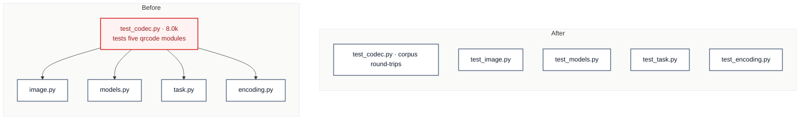

# C4 · `tests/qrcode/` mirrors `qrcode/`

[← Report](README.md)

🟢 **Strong** · `in-process` · builds on: —

`tests/qrcode/test_codec.py:1-865` · `tests/qr_test_utils.py` · `AGENTS.md` (names `tests/qrcode/test_codec.py` in Commands)

`src/pyxctsk/qrcode/` has no `codec.py`. `test_codec.py` (8,003 tokens, 15 commits in 3 months) tests five modules:

| Lines | Tests | Module |
|---|---|---|
| 1–316 | corpus and round-trip | `task.py` |
| 317–558 | field order, spec example and waypoints | `task.py` |
| 559–656 | probe, image reading, missing dependencies | `image.py` |
| 657–806 | nested models and the shape decision | `models.py`, `task.py` |
| 807–865 | polyline decoder | `encoding.py` |

| Problem | Solution | Wins |
|---|---|---|
| One test file, named after no module, tests five `qrcode/` modules and is the largest file in `tests/`. | Give each `qrcode/` module its own test file, as AGENTS.md's "`tests/` mirrors `src/pyxctsk/`" says. Keep the corpus round-trips as one file. | locality: a module's tests beside it restores the mirror convention |

- **Helpers:** `REFERENCE_TASKS` (line 44) and `_normalized` (line 92) move with the tests that use them. `tests/qr_test_utils.py` already holds the image helpers.
- **AGENTS.md:** its Commands example runs `tests/qrcode/test_codec.py`. Keep that path valid or update the example.

Decisions

<!-- filled during implementation, one line each -->

