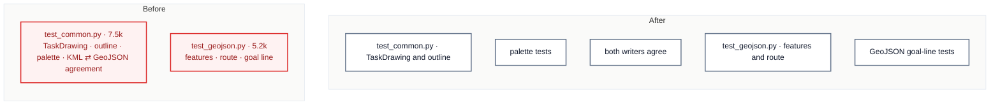

# C5 · Split the export tests; the writers' agreement gets its own file

[← Report](README.md)

🟢 **Strong** · `in-process` · builds on: —

`tests/export/test_common.py:1-709` · `tests/export/test_geojson.py:1-517` · `tests/builders.py`

`TestOnePalette` (`test_common.py:329-709`, ~4.2k tokens) is most of the file's 2,458-token overage. About half of it compares the KML and GeoJSON writers, which neither writer's test file shows.

| Problem | Solution | Wins |
|---|---|---|
| The `TaskDrawing` tests and the writers' agreement tests share one 7.5k file, and the GeoJSON tests are 206 tokens over. | Split `test_common.py` into drawing, palette and agreement files, and split the GeoJSON goal-line tests out of `test_geojson.py`. Move the shared task and drawing helpers out of the files. | locality: agreement tests in one place one helper instead of copies |

- **`_task` (`test_common.py:48`):** a goal-type variant of `tests/builders.py`'s `task()`.
- **`_drawing_of` (`test_geojson.py:51`):** used by both GeoJSON halves.
- **Placement:** decide between `builders.py` and an export conftest from who uses each helper.

Decisions

<!-- filled during implementation, one line each -->

