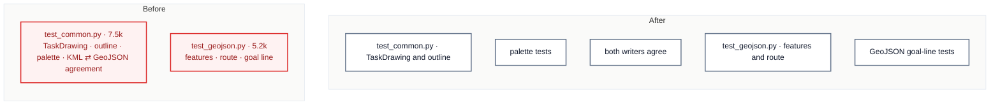

# C5 · Split the export tests; the writers' agreement gets its own file

[← Report](README.md)

🟢 **Strong** · `in-process` · builds on: —

`tests/export/test_common.py:1-709` · `tests/export/test_geojson.py:1-517` · `tests/builders.py`

`TestOnePalette` (`test_common.py:329-709`, ~4.2k tokens) is most of the file's 2,458-token overage. About half of it compares the KML and GeoJSON writers, which neither writer's test file shows.

| Problem | Solution | Wins |
|---|---|---|
| The `TaskDrawing` tests and the writers' agreement tests share one 7.5k file, and the GeoJSON tests are 206 tokens over. | Split `test_common.py` into drawing, palette and agreement files, and split the GeoJSON goal-line tests out of `test_geojson.py`. Move the shared task and drawing helpers out of the files. | locality: agreement tests in one place one helper instead of copies |

- **`_task` (`test_common.py:48`):** a goal-type variant of `tests/builders.py`'s `task()`.
- **`_drawing_of` (`test_geojson.py:51`):** used by both GeoJSON halves.
- **Placement:** decide between `builders.py` and an export conftest from who uses each helper.

Decisions

<!-- filled during implementation, one line each -->

- Q1 — How big are the two files? → `tests/export/test_common.py` is 7,457 tokens (709 lines, 52 tests) and `tests/export/test_geojson.py` 5,205 (517 lines, 26 tests), because `wc -c` ÷ 4 and `pytest --collect-only` say so; `test_kml.py` (3,061, 16 tests) stays untouched.
- Q2 — What stays in `test_common.py`? → `TestTaskDrawing` (`:74-166`), `TestTheCylinderOutline` (`:167-239`) and `TestOneDrawingTwoFormats` (`:240-304`), about 2,700 tokens, because those 1,000 + 809 + 644 tokens all test the `TaskDrawing` value, and `TestOneDrawingTwoFormats` patches `common.MeasuredTask` to pin that the drawing optimizes once (`:243-269`).
- Q3 — Where do the palette tests go? → new `tests/export/test_common_palette.py` (~1,300 tokens): `TestColorValue` (`:305-328`) and `TestOnePalette`'s docstring, `ROLES` and its four palette-only tests (`:329-345`, `:412-463`), because those 626 tokens never render a writer (no `drawing_to_*` in `:412-463`), and C3's `test_cli_errors.py` set the `test_<module>_<part>.py` naming.
- Q4 — Where does the writers' agreement go? → new `tests/export/test_writers_agree.py` (~3,500 tokens), class `TestBothWritersAgree`, holding `:464-709` (2,703 tokens, 14 test functions; twelve render both writers, and the two that do not, `:577` and `:611`, pin the drawing answers those writers share) plus `_placemark_style` and `_placemark_color` (`:346-391`, 444) as module functions, because every caller of those helpers (`:479`, `:641`, `:657`, `:674`, `:677`) is in that range.
- Q5 — Does `TestOneDrawingTwoFormats` move into the agreement file? → no, because adding its 644 tokens would take that file to ~4,150, over the 3,750 target, and it tests the drawing value rather than the rendered text.
- Q6 — Where does `_task_of_every_role` go? → into `test_writers_agree.py`, building `[*TurnpointType, TurnpointType.NONE]` directly, because its six callers (`:466`-`:618`) all move there and `[t for t, is_goal in ROLES if not is_goal]` equals `list(TurnpointType)`, so `ROLES` stays only in the palette file.
- Q7 — Where does `_task` (`test_common.py:48`) go? → `tests/builders.py` as `three_turnpoint_task(goal=None, middle_lat=46.0)`, built from `task()` and `turnpoint(..., alt=0, type=TurnpointType.NONE)`, because its 40 callers span all three `test_common*` files (palette at `:456`, `:458`), `tests/conftest.py` says a fixture file is a poor home for a function, and AGENTS.md sends made-up tasks to `tests/builders.py` (806 → ~950 tokens).
- Q8 — How does `test_geojson.py` split? → `TestLineGoalWithoutAnApproach` and `TestCreateGoalLineFeatures` (`:341-517`, 1,908 tokens) move to new `tests/export/test_geojson_goal_line.py` (~2,150), leaving ~3,350, because that range is the goal-line half and uses none of the module helpers.
- Q9 — Where do `_drawing_of`, `_route`, `_through_centres` and `_route_drawing` go? → they stay in `test_geojson.py`, because all seven `_drawing_of` uses (`:84-333`) and every other helper call (`:47`, `:64`, `:158`, `:168-213`, `:278`) stay on that side of `:341`.
- Q10 — Do the line-goal task-level tests move too? → no: `TestGenerateTaskGeoJSON.test_generate_task_geojson_line_goal` (`:253`) and `TestRepeatedTurnpoint` (`:304-340`) stay, because they test `generate_task_geojson` and `_drawing_of`, not `_create_goal_line_features`.
- Q11 — Is a golden or expected-output file involved? → no, because the card names none and the only golden values are the hex literals inside `test_geojson.py` (`:10-15`), which move verbatim; the Build proves behaviour by `pytest tests/export --collect-only -q` with the path and class stripped (`sed 's/.*:://' | sort`) matching before and after (94 tests), by asserting once that `three_turnpoint_task(g, lat) == _task(g, lat)` for each goal type, and by the full suite passing.
- Q12 — Which docs and comments name these files? → only `test_geojson.py:13` ("`test_common.py` holds the complementary check") changes, to `test_writers_agree.py`, and `test_common.py`'s module docstring (`:1-12`) loses its palette paragraph to the new files, because `grep -rn test_common` finds nothing in `src/`, `tests/distance/`, `AGENTS.md` or `README.md`; the dated reviews are history, the `test_layering.py` mention (`:694`) moves verbatim, and a test split is not user-visible, so `CHANGELOG.md` gets no entry.
- Q13 — Which files does the Build touch? → `test_common.py` (~2,700), `test_common_palette.py` (~1,300), `test_writers_agree.py` (~3,500), `test_geojson.py` (~3,350), `test_geojson_goal_line.py` (~2,150), `tests/builders.py` (~950), this card (~1,750) and `README.md` (2,747), because those are the measured sizes plus the moved ranges, and all are under 5,000.

