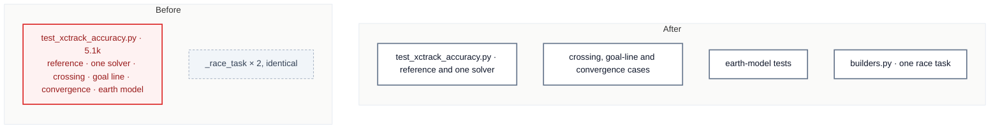

# C6 · Split the XCTrack accuracy tests

[← Report](README.md)

🟢 **Strong** · `in-process` · builds on: —

`tests/distance/test_xctrack_accuracy.py:1-457` · rides along: [S1](README.md#s1--two-identical-_race_task-builders) (`tests/distance/test_center_distance.py:23`, `tests/distance/test_measured_task.py:38`)

The file is 71 tokens over the budget and was touched in 14 commits in 3 months. It holds seven test classes:

| Lines | Classes |
|---|---|
| 70 | `TestReferenceAccuracy` |
| 152 | `TestOneSolverOneProjection` |
| 251 | `TestCrossingCase` |
| 325 | `TestGoalLine` |
| 358 | `TestConvergence` |
| 373–457 | `TestEarthModel`, `TestTheEarthModelSelector` |

| Problem | Solution | Wins |
|---|---|---|
| The reference-accuracy tests also carry geometry edge cases and the earth-model selector, which change for different reasons. | Split by what each class pins: the reference corpus, geometry cases, and earth model. Move the module constants to where every file can reach them. | locality: earth-model tests together S1: one race task builder |

- **Constants:** `WITH_REFERENCE`, `CONVERGENCE_SAMPLE` and `REF_QUANTIZATION_M` must be reachable from every file that uses them.

Decisions

<!-- filled during implementation, one line each -->

