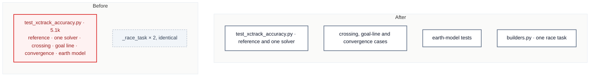

# C6 · Split the XCTrack accuracy tests

[← Report](README.md)

🟢 **Strong** · `in-process` · builds on: —

`tests/distance/test_xctrack_accuracy.py:1-457` · rides along: [S1](README.md#s1--two-identical-_race_task-builders) (`tests/distance/test_center_distance.py:23`, `tests/distance/test_measured_task.py:38`)

The file is 71 tokens over the budget and was touched in 14 commits in 3 months. It holds seven test classes:

| Lines | Classes |
|---|---|
| 70 | `TestReferenceAccuracy` |
| 152 | `TestOneSolverOneProjection` |
| 251 | `TestCrossingCase` |
| 325 | `TestGoalLine` |
| 358 | `TestConvergence` |
| 373–457 | `TestEarthModel`, `TestTheEarthModelSelector` |

| Problem | Solution | Wins |
|---|---|---|
| The reference-accuracy tests also carry geometry edge cases and the earth-model selector, which change for different reasons. | Split by what each class pins: the reference corpus, geometry cases, and earth model. Move the module constants to where every file can reach them. | locality: earth-model tests together S1: one race task builder |

- **Constants:** `WITH_REFERENCE`, `CONVERGENCE_SAMPLE` and `REF_QUANTIZATION_M` must be reachable from every file that uses them.

Decisions

<!-- filled during implementation, one line each -->

- Q1 — How big is the file? → 5,071 tokens (457 lines; 59 passed, 18 skipped), because `wc -c` ÷ 4 gives 20,284 ÷ 4 and `pytest -rA` gives `TestReferenceAccuracy` 28 + 18 skips, `TestOneSolverOneProjection` 4, `TestCrossingCase` 3, `TestGoalLine` 2, `TestConvergence` 5, `TestEarthModel` 3, `TestTheEarthModelSelector` 14.
- Q2 — What stays in `test_xctrack_accuracy.py`? → `TestReferenceAccuracy` (`:70-151`) and `TestOneSolverOneProjection` (`:152-250`) with `_has_concentric_pair` (`:58-67`), about 2,600 tokens, because those are 945 + 1,048 tokens and the card's After diagram keeps "reference and one solver" there; `test_task_distances.py:9, 40, 80` name this file for exactly the reference accuracy, so they stay true.
- Q3 — Where do the crossing, goal-line and convergence cases go? → new `tests/distance/test_route_optimization_cases.py` (~1,650 tokens) holding `TestCrossingCase`, `TestGoalLine` and `TestConvergence` (`:251-372`), because those are 922 + 376 + 146 tokens, all exercise `route_optimization.py`, `test_route_optimization.py` (4,166) cannot absorb 1,444 more, and C3 set the `test_<module>_<part>.py` naming.
- Q4 — Where do the earth-model tests go? → new `tests/distance/test_earth.py` (~1,100 tokens) holding `TestEarthModel` and `TestTheEarthModelSelector` (`:373-457`), because those are 401 + 565 tokens, the selector is `distance/earth.py`'s `canonical` reached through `geodesic_distance`, and no `tests/**/*earth*` file exists yet, so the name mirrors `src/`.
- Q5 — Where do `WITH_REFERENCE`, `CONVERGENCE_SAMPLE` and `REF_QUANTIZATION_M` go? → no shared module: `REF_QUANTIZATION_M` (used `:89-90`) and `WITH_REFERENCE` stay in `test_xctrack_accuracy.py`, and `test_route_optimization_cases.py` defines `CONVERGENCE_SAMPLE = tasks_with_reference_distance()[:5]` with its comment, because `CONVERGENCE_SAMPLE` is used only at `:361`, `tests/corpus.py:157` is already the one lookup, and `test_task_distances.py:37` sets the precedent of a file-local `WITH_REFERENCE = tasks_with_reference_distance()`; the sample stays the same first five tasks.
- Q6 — Where does `WGS84 = Geod(ellps="WGS84")` go? → one line in each of the three files, because all three use it (`:103-212`, `:263-314`, `:374-445`) and a shared module for a one-line constant would be a pass-through.
- Q7 — Where do the reference lookups go? → each file imports what it calls from `tests/corpus.py`: `reference_task` in all three (`:146`, `:330`, `:399`), `tasks_with_reference_distance` in the first two, because AGENTS.md finds reference tasks only through `tests/corpus.py` and no file globs.
- Q8 — Do the 18 skips stay? → yes, unchanged in `test_optimized_never_exceeds_centers`, which stays in `test_xctrack_accuracy.py`, because the skip at `:129` fires for the 18 of 22 reference tasks with consecutive concentric turnpoints, where touching semantics force an out-and-back leg so the centre distance is no upper bound; `test_concentric_out_and_back` (`:139`) covers that case on `task_nohe`.
- Q9 — Does the card name a golden comparison? → no, because the card names none and the file only reads reference distances through `ReferenceTask`; the Build proves behaviour by `pytest -rA` on the three files giving 59 passed and 18 skipped with the same per-class counts as Q1, and no change under `tests/data/`.
- Q10 — Which docstrings change? → the module docstring's bullets split by file (reference and centres stay; crossing, goal line and convergence move to `test_route_optimization_cases.py`; the new `test_earth.py` gets its own), and `TestOneSolverOneProjection`'s "every crossing-case test below" names `test_route_optimization_cases.py`, because those tests no longer sit below it (`:251`); the dated reports under `docs/arch-review/` that cite old line numbers stay as written.
- Q11 — Which files does the Build touch? → `test_xctrack_accuracy.py` (5,071 → ~2,600), new `test_route_optimization_cases.py` (~1,650) and `test_earth.py` (~1,100), `tests/builders.py` (979 → ~1,080), `test_center_distance.py` (2,833 → ~2,740), `test_measured_task.py` (4,544 → ~4,450), because `wc -c` ÷ 4 puts every one under 3,750 except `test_measured_task.py`, which drops; no `CHANGELOG.md` entry, as nothing user-visible changes.
- S1: Q1 — Are the two builders identical? → the bodies are, the docstrings are not, because `diff` of `test_center_distance.py:23-32` against `test_measured_task.py:38-47` differs only on line 2 ("pre-start leg and a goal cylinder, so all readings differ" against "speed section and a cylinder goal").
- S1: Q2 — What is the shared builder called? → `race_to_goal_cylinder_task()` in `tests/builders.py`, with one docstring naming the takeoff, SSS, one turnpoint and ESS on a cylinder goal, because `tests/builders.py:110` already names `three_turnpoint_task` by its shape and `test_speed_section.py:21` keeps its own `_race_task(goal_type)`, which has a separate ESS.
- S1: Q3 — Do the callers' imports change? → each file adds `race_to_goal_cylinder_task` to its `tests.builders` import and keeps `GoalType`, `TurnpointType`, `task` and `turnpoint`, because both still use them outside the builder (`GoalType.` 1 and 3 more times, `TurnpointType.` 9 and 4); the 8 call sites in `test_center_distance.py` and 11 in `test_measured_task.py` are renamed.

