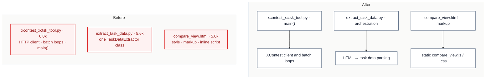

# C7 · Split the three oversized `scripts/` utilities

[← Report](README.md)

🟡 **Worth exploring** · `in-process` · builds on: —

`scripts/xcontest_xctsk_tool.py:1-705` · `scripts/extract_task_data.py:1-622` · `scripts/task_viewer/templates/compare_view.html:1-564` · rides along: [S2](README.md#s2--a-process-branch-that-never-runs)

None of the three files has had a commit in 3 months, and the published wheel ships none of them. They block only the commit that next touches them.

| Problem | Solution | Wins |
|---|---|---|
| Three repository utilities can't be edited without a split first. | Split each along its seam: the XContest HTTP client from the CLI, the HTML parsing from the extractor's orchestration, and the viewer's inline script and style into `static/`. Every entry point stays where it is. | locality: HTTP apart from argparse S2: dead branch gone |

- **The template:** it has only two Jinja expressions in its script (lines 373–374). `geojson_debug_view.html:284-287` already passes data in a `<script type="application/json">` block.
- **Docs:** `scripts/README.md` and `scripts/task_viewer/README.md` list these files.

Decisions

<!-- filled during implementation, one line each -->

- Q1 — Where does the XContest client go? → `scripts/xcontest_client.py` holds `XCTSKClient` and the four batch loops (`upload_directory`, `download_tasks`, `download_html_tasks`, `process_all_tasks`); `xcontest_xctsk_tool.py` keeps its docstring, the argparse setup and `main()`, because `main()` is the loops' only caller (no other file imports the tool) and the client and loops are lines 31–463 of 705.
- Q2 — How does the tool reach the client? → a sibling import, `from xcontest_client import …`, because a script run as `python scripts/<name>.py` has `scripts/` on `sys.path`, the way `task_viewer/app.py:11` imports `from api import api_bp`.
- Q3 — Does the HTML parsing stay a class? → no, it becomes module functions in `scripts/task_html_parser.py` with `extract_task_data(html)` as the entry point, because the ten parsing methods (`extract_task_data.py:86-412`, `:451-478`) read no instance state: every `self.` in them calls another of them. `TaskDataExtractor` keeps the file I/O, the logging of what was found and the directory loops.
- Q4 — What does `save_data_to_file` call to check GeoJSON? → `task_html_parser.validate_geojson`, the old `_validate_geojson` made public, because the extractor calls it from outside the parser (`extract_task_data.py:431`).
- Q5 — Does the parser get its own logging setup? → no, `logging.getLogger(__name__)`, with `basicConfig` left in `extract_task_data.py`, because the format `%(levelname)s: %(message)s` prints no logger name, so the log reads the same.
- Q6 — Static files or Jinja includes for the template? → includes, `templates/compare_view/style.html` and `templates/compare_view/map_script.html`, because the script holds two Jinja expressions (`compare_view.html:373-374`) and an include renders the same page byte for byte, while a static `.js` needs the data moved into a JSON block and changes the page.
- Q7 — Which `process` branch stays (S2)? → the first, because `process_parser` defines `--xctsk-dir` and no `--directory`, so the second branch (`:682`) would raise `AttributeError` if it were reachable; it never is, as the first `elif` on the same test always wins.
- Q8 — How is behaviour proved? → before and after runs compared byte for byte, because nothing in `tests/` imports these scripts: every `--help` the tool prints; 14 tool runs against a local fake XContest server (upload, download v1 and v2, qr, html, process, and their error paths), output files included; `extract_task_data.py` over the 25 downloaded pages, logs and the 75 files it writes; and `compare_view.html` rendered through the Flask app for the 25 tasks, plus its error branch.
- Q9 — Which docs change? → the trees in `scripts/README.md` and `scripts/task_viewer/README.md` and one line each in the two scripts' `scripts/README.md` sections, because those list the files; no `CHANGELOG.md` entry, as the wheel ships no `scripts/`.

