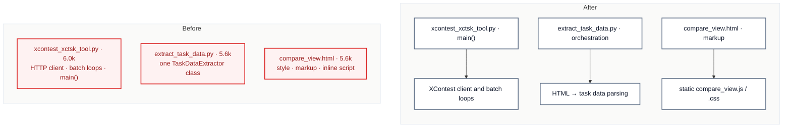

# C7 · Split the three oversized `scripts/` utilities

[← Report](README.md)

🟡 **Worth exploring** · `in-process` · builds on: —

`scripts/xcontest_xctsk_tool.py:1-705` · `scripts/extract_task_data.py:1-622` · `scripts/task_viewer/templates/compare_view.html:1-564` · rides along: [S2](README.md#s2--a-process-branch-that-never-runs)

None of the three files has had a commit in 3 months, and the published wheel ships none of them. They block only the commit that next touches them.

| Problem | Solution | Wins |
|---|---|---|
| Three repository utilities can't be edited without a split first. | Split each along its seam: the XContest HTTP client from the CLI, the HTML parsing from the extractor's orchestration, and the viewer's inline script and style into `static/`. Every entry point stays where it is. | locality: HTTP apart from argparse S2: dead branch gone |

- **The template:** it has only two Jinja expressions in its script (lines 373–374). `geojson_debug_view.html:284-287` already passes data in a `<script type="application/json">` block.
- **Docs:** `scripts/README.md` and `scripts/task_viewer/README.md` list these files.

Decisions

<!-- filled during implementation, one line each -->

