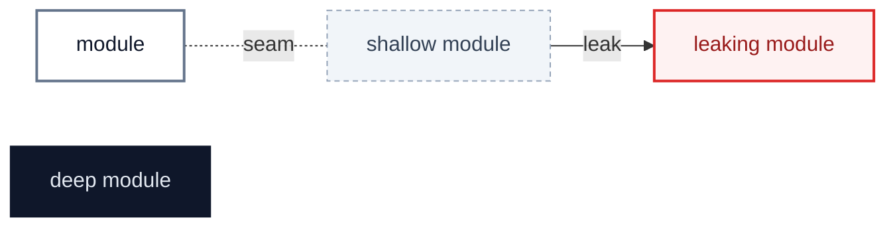

# pyxctsk: thirteen hand-written files block their next commit once the token budget is enforced

`2026-10-20` · at `6f728ab` (`docs/arch-review-token-budget`) · scope: every tracked file over the 5,000-token budget of the shared [`check-file-tokens.py`](https://github.com/simonsteiner/skills/blob/filetokens.v1.0.0/.lefthook/pre-commit/check-file-tokens.py), then the `lefthook.yml` job that enforces it · glossary: `GLOSSARY.md` · ADRs read: 0001–0004 (none bears on a split)

**Jump to:** [Status](#status) · [Where it hurts](#where-it-hurts) · [Since the last review](#since-the-last-review) · [Smaller findings](#smaller-findings) · [Recommendation](#recommendation) · cards: [C1](C1-changelog-keeps-the-open-release.md) · [C2](C2-split-the-model-tables.md) · [C3](C3-split-the-front-door-tests.md) · [C4](C4-qrcode-tests-mirror-qrcode.md) · [C5](C5-split-the-export-tests.md) · [C6](C6-split-the-distance-tests.md) · [C7](C7-split-the-scripts.md)

Legend

## Status

The backlog, in rank order. After the scan only three parts of the report change: this table, each card's **Decisions**, and **Departures**. The findings stay as found.

| ID | Deepening | Strength | Lens | Status | Branch | PR | Breaking | Notes |
|---|---|---|---|---|---|---|---|---|
| [C1](C1-changelog-keeps-the-open-release.md) | `CHANGELOG.md` keeps the open release; released ones move out | 🟢 Strong | maintainability | dropped | `refactor/changelog-archive` | | | the `file-tokens` job excludes `CHANGELOG.md` instead; see Departures |
| [C2](C2-split-the-model-tables.md) | Split `model/shape.py` and `model/task.py` along their seams | 🟢 Strong | maintainability | todo | `refactor/split-model` | | | |
| [C3](C3-split-the-front-door-tests.md) | Split the CLI and layering tests | 🟢 Strong | maintainability | todo | `refactor/split-front-door-tests` | | | |
| [C4](C4-qrcode-tests-mirror-qrcode.md) | `tests/qrcode/` mirrors `qrcode/` | 🟢 Strong | maintainability | todo | `refactor/split-qrcode-tests` | | | |
| [C5](C5-split-the-export-tests.md) | Split the export tests; the writers' agreement gets its own file | 🟢 Strong | maintainability | todo | `refactor/split-export-tests` | | | |
| [C6](C6-split-the-distance-tests.md) | Split the XCTrack accuracy tests | 🟢 Strong | maintainability | todo | `refactor/split-distance-tests` | | | |
| [S1](#s1--two-identical-_race_task-builders) | Two identical `_race_task` builders | — | maintainability | todo | rides with C6 | | | |
| [S3](#s3--nothing-enforces-the-budget) | Nothing enforces the budget | — | maintainability | pr-open | `chore/shared-file-tokens` | [#43](https://github.com/simonsteiner/pyxctsk/pull/43) | | landed first; see Departures |
| [C7](C7-split-the-scripts.md) | Split the three oversized `scripts/` utilities | 🟡 Worth exploring | maintainability | todo | `refactor/split-scripts` | | | no commit in 3 months |
| [S2](#s2--a-process-branch-that-never-runs) | A `process` branch that never runs | — | maintainability | todo | rides with C7 | | | |
| [S4](#s4--the-existing-hook-jobs-break-three-setup-rules) | The existing hook jobs break three setup rules | — | maintainability | todo | | | | follow-up, not in this rollout |

Strength: 🟢 Strong · 🟡 Worth exploring · ⚪ Speculative · 🔴 live defect (a bug reproduced during the scan).
Status: `todo` · `in-progress` · `pr-open` · `merged` · `blocked` · `dropped`. `blocked` and `dropped` always carry a reason in Notes.

## Where it hurts

```mermaid
flowchart LR
  subgraph hot["Touched in 3 months"]
    direction TB
    CL["CHANGELOG.md · 23.9k · 94 commits"]:::leak
    SH["model/shape.py · 7.0k"]:::module
    TA["model/task.py · 5.5k"]:::module
    QC["tests/qrcode/test_codec.py · 8.0k"]:::module
    EC["tests/export/test_common.py · 7.5k"]:::module
    CLI["tests/test_cli.py · 6.2k"]:::module
  end
  subgraph cold["Untouched in 3 months"]
    direction TB
    XC["scripts/xcontest_xctsk_tool.py · 6.0k"]:::shallow
    ET["scripts/extract_task_data.py · 5.6k"]:::shallow
    CV["task_viewer compare_view.html · 5.6k"]:::shallow
  end
  hot ~~~ cold
  classDef module fill:#ffffff,stroke:#64748b,stroke-width:2px,color:#0f172a
  classDef shallow fill:#f1f5f9,stroke:#94a3b8,stroke-dasharray:4 3,color:#334155
  classDef leak fill:#fef2f2,stroke:#dc2626,stroke-width:2px,color:#991b1b
```

After `.gitattributes` marks what nobody edits by hand (downloaded XContest pages, the vendored AirScore copy, eleven dated single-file reports), 13 hand-written files remain over 5,000 tokens. `CHANGELOG.md` is in 94 of the last 3 months' commits, so every user-visible PR would be blocked by it.

- **Also over:** `tests/model/test_shape.py` 5.4k (C2) · `tests/export/test_geojson.py` 5.2k (C5) · `tests/test_layering.py` 5.1k (C3) · `tests/distance/test_xctrack_accuracy.py` 5.1k (C6).
- **Watch list** (over 4,250, under 5,000): `src/pyxctsk/qrcode/task.py` 4.7k · `tests/distance/test_measured_task.py` 4.5k · `src/pyxctsk/parser.py` 4.5k · `tests/conformance/test_parser_diagnostics.py` 4.3k. Each one's next large change splits it.
- **Not over:** `CLAUDE.md` no longer exists. It became `AGENTS.md` in #41, which is 2.7k.

## Since the last review

- `2026-10-02 C1–C6, S1–S11`: merged in #29–#35, though that report's table still says `pr-open`. `S12` was dropped.
- `2026-10-02 S13`: still open. `dump_json(float("nan"), layout="compact")` writes `NaN` at `6f728ab`.
- `2026-10-02 S14`: still open. `load_json("[" * 100000 + "]" * 100000)` raises `RecursionError` at `6f728ab`.
- `2026-10-02 S15`: still open, not rechecked.

## Smaller findings

### S1 · Two identical `_race_task` builders

`tests/distance/test_center_distance.py:23` · `tests/distance/test_measured_task.py:38` · rides with C6

Both files build the same four-turnpoint task (`A`/`S`/`C`/`G`, ESS at goal, cylinder goal). `test_speed_section.py:21` has a different one with a separate ESS. Move the shared one to `tests/builders.py` under a name that says what it is.

### S2 · A `process` branch that never runs

`scripts/xcontest_xctsk_tool.py:682` · rides with C7

`main()` tests `args.command == "process"` at `:669` and again at `:682`, so the second branch, with its different argument names, is dead. Delete it and keep the branch that matches the `process` subparser.

### S3 · Nothing enforces the budget

`lefthook.yml` · own PR, `chore/file-tokens-hook`, last in the stack

`scripts/hooks/check-file-tokens.py` exists from this report's PR but no job runs it. Add setup-lefthook's `file-tokens` job (no `glob:`, every file type), prove a file over the budget fails, and list in that PR any hand-written file still over the budget.

### S4 · The existing hook jobs break three setup rules

`lefthook.yml:9-33` · follow-up, not in this rollout

Every job sets `priority:` under `parallel: true`, which lefthook ignores (the file's own comment says so). `mypy` runs on `{staged_files}`, though a strict type check gives a different answer on a subset, and `cspell` runs `npx --yes cspell` with no pinned version. Each fix touches the existing jobs, which the rollout leaves alone.

## Recommendation

> [!IMPORTANT]
> **Start with [C1 · `CHANGELOG.md` keeps the open release](C1-changelog-keeps-the-open-release.md)**: nearly every PR touches it, so once S3 lands, every user-visible change would be blocked.
>
> **Proposed batch** (every 🟢 Strong, in order, with S1 in C6 and S3 last): C1 → C2 → C3 → C4 → C5 → C6 → S3

## Departures

<!-- filled during implementation: where a PR deliberately differs from this report, and why -->

- **The `file-tokens` job (S3) landed before the splits, from a shared script.** [#43](https://github.com/simonsteiner/pyxctsk/pull/43) added it to `lefthook.yml` running the shared [`check-file-tokens.py`](https://github.com/simonsteiner/skills/blob/filetokens.v1.0.0/.lefthook/pre-commit/check-file-tokens.py), which lefthook fetches from [simonsteiner/skills](https://github.com/simonsteiner/skills) pinned to the tag `filetokens.v1.0.0`, and deleted the copy in `scripts/hooks/`. Until its split lands, a commit that touches a file this report lists is blocked, so each split commit leaves every file it touches under the budget.
- **C1 dropped: the `file-tokens` job excludes `CHANGELOG.md` instead of the file being split** ([#43](https://github.com/simonsteiner/pyxctsk/pull/43)). Keeping only the open release and the newest one would fit today (v0.7.0's notes are about 3,650 tokens), but v0.6.0's notes alone are about 17,400, so a release that size would block entries again partway through its cycle. The archive would have needed marking too, and the release tooling's duplicate-version guard would have needed to read it. The file grows only at the top, and an entry in `[Unreleased]` is written without reading the releases below it. The exclude sits on the job, not in `.gitattributes`, because `linguist-generated` would collapse the changelog diff in every PR.
