# C1 · `load_json` reads only what `dump_json` can write

[← Report](README.md)

🟢 **Strong** · 🔴 **live defect** · `in-process` · ↔ `two-way` · builds on: none

`src/pyxctsk/model/json_io.py:49-105` · `src/pyxctsk/model/passthrough.py:35-110` · `src/pyxctsk/model/codec.py:21,209` · `src/pyxctsk/parser.py:150-156`

```mermaid
flowchart LR
  subgraph before["Before"]
    direction TB
    P1["parser · Task.from_json · QRCodeTask.from_json"]:::module --> L1["load_json · json.loads"]:::shallow
    L1 --> S1["spec fields · TEXT, NUMBER codecs"]:::module
    L1 -- "leak: NaN, lone surrogate" --> X1["passthrough · carried unchecked"]:::leak
    X1 --> D1["dump_json · writes NaN, raises UnicodeEncodeError"]:::leak
  end
  subgraph after["After"]
    direction TB
    P2["parser · Task.from_json · QRCodeTask.from_json"]:::module --> J2["json_io · load_json / dump_json"]:::deep
    subgraph inside[" "]
      direction TB
      A2["refuses NaN and Infinity"]:::faded
      B2["refuses a lone surrogate, at a path"]:::faded
      C2["refuses nesting it cannot decode"]:::faded
    end
    J2 -.- inside
  end
  before ~~~ after
  classDef module fill:#ffffff,stroke:#64748b,stroke-width:2px,color:#0f172a
  classDef shallow fill:#f1f5f9,stroke:#94a3b8,stroke-dasharray:4 3,color:#334155
  classDef deep fill:#0f172a,stroke:#0f172a,color:#e2e8f0
  classDef faded fill:#1e293b,stroke:#475569,color:#94a3b8
  classDef leak fill:#fef2f2,stroke:#dc2626,stroke-width:2px,color:#991b1b
  style inside fill:#0f172a,stroke:#0f172a
  style before fill:#fafaf9,stroke:#e2e8f0
  style after fill:#fafaf9,stroke:#e2e8f0
```

> [!CAUTION]
> **Live defect, three ways, all from the CLI at `12c3e50`** (a two-turnpoint task with one unknown root key `"x"`):
>
> - `"x":"\ud800"` → `pyxctsk convert task.xctsk --format json` dies with `UnicodeEncodeError: ... surrogates not allowed`, a traceback outside `pyXCTSKError`.
> - `"x":NaN` → the same command exits 0 and writes `..."x":NaN}`, which is not JSON (RFC 8259 has no `NaN`).
> - a file of `"[" * 100000 + "]" * 100000` → `pyxctsk convert deep.json --format json` dies with `RecursionError`, outside `pyXCTSKError`.

**Removes:**

- `src/pyxctsk/model/json_io.py:93-97`: the `dump_json` docstring's caveat that a lone surrogate "cannot arrive from a parsed task", true only of spec fields.
- `src/pyxctsk/model/json_io.py:63`: `load_json` catches `ValueError` but not `RecursionError`, so its `MalformedPayloadError` promise has a hole.
- `src/pyxctsk/model/passthrough.py:35`: `read_passthrough` carries strings and numbers no spec field would accept, the gap 2026-10-02 S15 named.
- 2026-10-02 S13 (`dump_json` writes `NaN`), S14 (`RecursionError`), S15 (passthrough text): three open rows, one fix.

| Problem | Solution | Wins |
|---|---|---|
| The codecs hold spec fields to what JSON and UTF-8 can carry, but `load_json` lets anything `json.loads` takes into passthrough, where nothing checks it before `dump_json` meets it. | The JSON module owns the round trip: what `load_json` returns, `dump_json` can write, and anything else is a `MalformedPayloadError` at read. | locality: JSON's limits in one module every bad input is `pyXCTSKError` output is always valid JSON three open rows closed |

Decisions

<!-- filled during implementation, one line each -->

Reproduced at `160545e` (same code as `12c3e50` under `src/`); dependency category: in-process.

- **Q1:** Where does the round trip get its locality? → In the `model/json_io.py` module, behind the `load_json(text)` and `dump_json(value, *, layout)` interface as it stands (signatures unchanged, only the error modes grow), because every read reaches `load_json` (3 call sites: `parser.py:153`, `model/task.py:182`, `qrcode/task.py:278`) and every write reaches `dump_json` (5 call sites), so this seam is the one place JSON's limits can live. Design-it-twice is skipped: those 8 callers fix the interface's shape, so it is not open.
- **Q2:** Does the QR path share the fix? → Yes, with no QR-side code, because `XCTSK:{…,"x2":NaN}` through `convert --format qrcode-json` writes `…,"x2":NaN}` with exit 0, and `"x2":"\ud800"` raises `UnicodeEncodeError` for both `qrcode-json` and `json` (reproduced). `XCTSK:`, `XCTSKZ:` and PNG input all reach `load_json` through `QRCodeTask.from_string` → `from_json`, and `_read_xctsk_url` already turns its `MalformedPayloadError` into an `InvalidFormatError` that carries the reason (`parser.py:224-229`).
- **Q3:** What does `load_json` refuse? → After `json.loads`, one walk of the decoded value refuses three things, each as a `MalformedPayloadError`: a float that is not finite, a string (key or value) that UTF-8 cannot encode, and nesting deeper than the Q4 bound. It also catches `RecursionError` from `json.loads` next to `ValueError`. The evidence, all reproduced: `NaN`, `[Infinity]` and `1e999` each write `NaN` or `Infinity`, `"\ud800"` raises `UnicodeEncodeError`, and nesting of 992 or more raises `RecursionError` inside `json.loads`. `json.loads` reads `1e999` as `inf` through float parsing, not `parse_constant`, so a `parse_constant` hook alone would miss it. A walk is better than the `parse_constant`/`parse_float`/`object_pairs_hook` hooks because hooks give no path and `object_pairs_hook` never sees a string inside an array.
- **Q4:** How deep may a document nest? → At most 100 containers, a module constant with no config, because catching `RecursionError` alone leaves a hole: nesting 990 loads, and then `render_task(task, "json")` raises `RecursionError` inside `json.dumps` (measured, recursion limit 1000). Across the 24 corpus tasks the deepest input nests 5 and the deepest GeoJSON output 8, and RFC 8259 §9 lets a parser limit nesting depth. With the bound in place, a recursive walk is bounded too.
- **Q5:** How does a refusal say where it happened? → As `MalformedPayloadError(reason, path)` with the field tables' path syntax (`turnpoints[0].radius`, `x`, `x[0]`). The reason: `test_a_non_finite_radius_names_where` (radius `NaN`, `inf`) and `test_a_name_utf8_cannot_carry_is_refused` in `tests/conformance/test_parser_diagnostics.py` match `turnpoints\[0\]\.radius` and `waypoint\.name`, and after this change `load_json` refuses those payloads before any table reads them. The same path keeps both tests passing, unchanged.
- **Q6:** How does that reason reach a `parse_task` caller? → `parser.Input` keeps the `MalformedPayloadError` that `load_json` raised, and `_unrecognized` appends its message after "looks like JSON". Today `Input.of` swallows the error into `_NOT_JSON` (`parser.py:150-155`) and `_unrecognized` says only "looks like JSON, but it is not a task in any format" (`parser.py:361`), which is what a 5,000-digit integer already gets (reproduced). For a valid task whose only fault is `"x":NaN` that message is false, and Q5's tests need the path. `test_truncated_json_is_named_as_json` matches only "looks like JSON", so it survives.
- **Q7:** What does `dump_json` do with a value built in code that holds a NaN, an Infinity, a lone surrogate or nesting over the bound? → It runs the same walk and raises the same `MalformedPayloadError` before calling `json.dumps`. Today such a value is written as `NaN`, because there is no `allow_nan=False`, or as a str that fails later at the CLI's UTF-8 write.
  - The writer cannot rely on the reader: the model does not validate on construction (AGENTS.md), `Task.from_dict` and `QRCodeTask.from_dict` are public and take dicts that never went through `load_json`, and the GeoJSON and the distance report hold computed floats.
  - `MalformedPayloadError` is a `ValueError` (`exceptions.py:96`), so a caller that catches what `json.dumps(allow_nan=False)` raises still catches it, and the CLI's `except (pyXCTSKError, OSError)` (`cli.py:205,275`) prints it instead of a traceback.
  - Cost: walking every corpus GeoJSON took 1 ms in total, against 2 ms for `json.dumps`.
  - The caveat at `json_io.py:93-97` goes, and `MalformedPayloadError`'s docstring ("the one error reading a task raises") adds the write side.
- **Q8:** What about a str handed to `parse_task` that holds a raw lone surrogate? → `Input.of` refuses it as `InvalidFormatError` instead of encoding it blindly, because `parse_task('{"x":"\ud800"}')` raises `UnicodeEncodeError` from `data.encode("utf-8")` at `parser.py:142` (reproduced). That is a fourth error of the same kind escaping `pyXCTSKError`. The CLI reads bytes and cannot hit it, but callers of the library can.
- **Q9:** Do passthrough and the codecs change? → No: `read_passthrough` and `write_passthrough` stay as they are, and so do `TEXT`'s surrogate check and the numeric codecs' finiteness check.
  - Passthrough carries values verbatim (AGENTS.md: unknown keys are preserved, never interpreted). With Q3 and Q7 in place, every passthrough value from JSON can be written, and one from a `from_dict` dict is caught at write.
  - The codecs still guard `from_dict` dicts, where a NaN radius would otherwise reach the solver (`tests/model/test_codec.py:56,109`).
  - Only codec.py's docstring sentence that Python's `json` reads `NaN` and `Infinity` changes wording, since `load_json` no longer returns them.
- **Q10:** Is this a one-way door? → No, it is two-way, because no published format changes and a revert restores today's behaviour. Every input still accepted writes the same bytes: the 24 corpus tasks nest at most 5 deep and hold no non-finite number or surrogate (checked, inputs and reference JSON). What is newly refused is one of three things: not JSON at all (RFC 8259 §6 permits no `NaN` or `Infinity`), something no JSON output could write (the surrogate crashed every one), or nesting RFC 8259 §9 lets a parser refuse.
- **Q11:** Which callers and tests change? → Callers: only `parser.py` (Q6, Q8). `model/task.py`, `qrcode/task.py`, `renderer.py` and `cli.py` stay as they are, because they already go through `load_json` and `dump_json`.
  - New interface tests go in `tests/model/test_json_io.py`, a new file mirroring `model/json_io.py`: each refusal with its path, in both directions, the bound, and accepted values round-tripping.
  - The three CLI reproductions and the `XCTSK:` one become regressions in `tests/conformance/test_parser_diagnostics.py`, run through `parse_task` and `render_task`.
  - No test is deleted, because the existing parser-diagnostics tests cross the same seam and survive (Q5, Q6).
- **Q12:** Is this a user-visible change? → Yes: a `### Fixed` entry under `## [Unreleased]` in CHANGELOG.md. It says that a `NaN`, an `Infinity`, an overflowing number, a lone surrogate or nesting deeper than 100, anywhere in a payload (extensions and unknown keys included), is now refused by every command. Today `nan.xctsk` converts to KML and GeoJSON with exit 0 (reproduced), and that stops.

