# C1 · `load_json` reads only what `dump_json` can write

[← Report](README.md)

🟢 **Strong** · 🔴 **live defect** · `in-process` · ↔ `two-way` · builds on: none

`src/pyxctsk/model/json_io.py:49-105` · `src/pyxctsk/model/passthrough.py:35-110` · `src/pyxctsk/model/codec.py:21,209` · `src/pyxctsk/parser.py:150-156`

```mermaid
flowchart LR
  subgraph before["Before"]
    direction TB
    P1["parser · Task.from_json · QRCodeTask.from_json"]:::module --> L1["load_json · json.loads"]:::shallow
    L1 --> S1["spec fields · TEXT, NUMBER codecs"]:::module
    L1 -- "leak: NaN, lone surrogate" --> X1["passthrough · carried unchecked"]:::leak
    X1 --> D1["dump_json · writes NaN, raises UnicodeEncodeError"]:::leak
  end
  subgraph after["After"]
    direction TB
    P2["parser · Task.from_json · QRCodeTask.from_json"]:::module --> J2["json_io · load_json / dump_json"]:::deep
    subgraph inside[" "]
      direction TB
      A2["refuses NaN and Infinity"]:::faded
      B2["refuses a lone surrogate, at a path"]:::faded
      C2["refuses nesting it cannot decode"]:::faded
    end
    J2 -.- inside
  end
  before ~~~ after
  classDef module fill:#ffffff,stroke:#64748b,stroke-width:2px,color:#0f172a
  classDef shallow fill:#f1f5f9,stroke:#94a3b8,stroke-dasharray:4 3,color:#334155
  classDef deep fill:#0f172a,stroke:#0f172a,color:#e2e8f0
  classDef faded fill:#1e293b,stroke:#475569,color:#94a3b8
  classDef leak fill:#fef2f2,stroke:#dc2626,stroke-width:2px,color:#991b1b
  style inside fill:#0f172a,stroke:#0f172a
  style before fill:#fafaf9,stroke:#e2e8f0
  style after fill:#fafaf9,stroke:#e2e8f0
```

> [!CAUTION]
> **Live defect, three ways, all from the CLI at `12c3e50`** (a two-turnpoint task with one unknown root key `"x"`):
>
> - `"x":"\ud800"` → `pyxctsk convert task.xctsk --format json` dies with `UnicodeEncodeError: ... surrogates not allowed`, a traceback outside `pyXCTSKError`.
> - `"x":NaN` → the same command exits 0 and writes `..."x":NaN}`, which is not JSON (RFC 8259 has no `NaN`).
> - a file of `"[" * 100000 + "]" * 100000` → `pyxctsk convert deep.json --format json` dies with `RecursionError`, outside `pyXCTSKError`.

**Removes:**

- `src/pyxctsk/model/json_io.py:93-97`: the `dump_json` docstring's caveat that a lone surrogate "cannot arrive from a parsed task", true only of spec fields.
- `src/pyxctsk/model/json_io.py:63`: `load_json` catches `ValueError` but not `RecursionError`, so its `MalformedPayloadError` promise has a hole.
- `src/pyxctsk/model/passthrough.py:35`: `read_passthrough` carries strings and numbers no spec field would accept, the gap 2026-10-02 S15 named.
- 2026-10-02 S13 (`dump_json` writes `NaN`), S14 (`RecursionError`), S15 (passthrough text): three open rows, one fix.

| Problem | Solution | Wins |
|---|---|---|
| The codecs hold spec fields to what JSON and UTF-8 can carry, but `load_json` lets anything `json.loads` takes into passthrough, where nothing checks it before `dump_json` meets it. | The JSON module owns the round trip: what `load_json` returns, `dump_json` can write, and anything else is a `MalformedPayloadError` at read. | locality: JSON's limits in one module every bad input is `pyXCTSKError` output is always valid JSON three open rows closed |

Decisions

<!-- filled during implementation, one line each -->

