# C2 · The drawing hands each writer features, not thirteen questions

[← Report](README.md)

🟢 **Strong** · `in-process` · ↔ `two-way` · builds on: none

`src/pyxctsk/export/common.py:102-310` · `src/pyxctsk/export/kml.py:85-184` · `src/pyxctsk/export/geojson.py:30-160` · `tests/export/test_common.py` · `tests/export/test_writers_agree.py` · `tests/export/test_geojson_goal_line.py:9`

```mermaid
flowchart LR
  subgraph before["Before"]
    direction TB
    K1["kml.py"]:::module
    G1["geojson.py"]:::module
    T1["TaskDrawing · is_goal · outline_of · color_of · label_of · description_of · role_of · route_label · goal_line_label · goal_line_description · control_zone_label · control_zone_description · route_coordinates · route_coordinates_lon_lat"]:::shallow
    K1 -- "10 of its 13 methods" --> T1
    G1 -- "10 of its 13 methods" --> T1
  end
  subgraph after["After"]
    direction TB
    K2["kml.py · serializes"]:::module --> F2["TaskDrawing · the features to draw"]:::deep
    G2["geojson.py · serializes"]:::module --> F2
    subgraph inside[" "]
      direction TB
      A2["turnpoint: name, description, colour, role, centre, radius, outline"]:::faded
      B2["route: name, lon-lat points"]:::faded
      C2["goal line and control zone: name, description, geometry"]:::faded
    end
    F2 -.- inside
  end
  before ~~~ after
  classDef module fill:#ffffff,stroke:#64748b,stroke-width:2px,color:#0f172a
  classDef shallow fill:#f1f5f9,stroke:#94a3b8,stroke-dasharray:4 3,color:#334155
  classDef deep fill:#0f172a,stroke:#0f172a,color:#e2e8f0
  classDef faded fill:#1e293b,stroke:#475569,color:#94a3b8
  classDef leak fill:#fef2f2,stroke:#dc2626,stroke-width:2px,color:#991b1b
  style inside fill:#0f172a,stroke:#0f172a
  style before fill:#fafaf9,stroke:#e2e8f0
  style after fill:#fafaf9,stroke:#e2e8f0
```

`TaskDrawing` has 13 public methods, most of them one to three lines, and each writer calls 10 of them; `export/common.py` is in 20 commits in six months, and 75% of `kml.py`'s commits and 80% of `geojson.py`'s also touch it.

**Removes:**

- `src/pyxctsk/export/common.py:237-253,259-274`: `goal_line_description` and `control_zone_description` raise `ValueError` unless the caller checked `goal_line` first, an ordering rule each writer has to know.
- `src/pyxctsk/export/common.py:219-235,255-257`: `route_label`, `goal_line_label`, `control_zone_label` return constants and read nothing from the drawing.
- `src/pyxctsk/export/common.py:164,202,217`: `turnpoint.type or TurnpointType.NONE` normalized three times, though `role_of` exists to be the one reading.
- `src/pyxctsk/export/common.py:276-300`: `route_coordinates` and `route_coordinates_lon_lat`, two orders of one route; the first is a helper of the second whose only outside callers are tests.
- `src/pyxctsk/export/common.py:102`: `is_goal`, public for `color_of` and tests.
- `tests/export/test_geojson_goal_line.py:9`: the test that imports `_create_goal_line_features` (S4).

| Problem | Solution | Wins |
|---|---|---|
| The 2026-08-19 review moved each shared answer onto `TaskDrawing` as its own accessor, so the drawing's interface grew to match its implementation, and both writers still walk the same four kinds of thing asking the same questions in the same order. | The drawing yields the features to draw (turnpoints, the route, the goal line, the control zone), each a value carrying its name, description, colour and geometry; the writers only serialize them. | interface shrinks to the features no call-order rule agreement test compares features once a new caption changes one module |

> [!NOTE]
> The 2026-08-19 review's card D stopped at accessors on purpose, to land the shared answers first; this is the step after it, not a reversal. KML, GeoJSON and the distance report must stay byte-identical across the corpus.

Decisions

<!-- filled during implementation, one line each -->

