# C3 · One way to the distance table, owned by its one consumer

[← Report](README.md)

🟡 **Worth exploring** · `in-process` · ↔ `two-way` · builds on: none

`src/pyxctsk/distance/task_distances.py:1-204` · `src/pyxctsk/distance/report.py:91-123,260-289` · `src/pyxctsk/distance/__init__.py:93-140` · `src/pyxctsk/__init__.py:44-54,104-147` · `scripts/task_viewer/api.py:154-163` · `scripts/task_viewer/app.py:146-151` · `tests/distance/test_task_distances.py`

```mermaid
flowchart LR
  subgraph before["Before"]
    direction TB
    V1["scripts/task_viewer · api.py, app.py"]:::module --> D1["TaskDrawing.from_task"]:::module
    V1 --> F1["task_distances_from(drawing.measured)"]:::shallow
    C1["calculate_task_distances"]:::shallow --> F1
    F1 --> T1["TaskDistanceTable.from_report · copies RouteRow into TurnpointRow"]:::shallow
    T1 --> R1["DistanceReport · RouteRow"]:::deep
  end
  subgraph after["After"]
    direction TB
    V2["scripts/task_viewer"]:::module --> D2["TaskDrawing.from_task"]:::module
    V2 --> R2["DistanceReport · the one value"]:::deep
    subgraph inside[" "]
      direction TB
      A2["kilometres at board precision"]:::faded
      B2["one row type"]:::faded
    end
    R2 -.- inside
  end
  before ~~~ after
  classDef module fill:#ffffff,stroke:#64748b,stroke-width:2px,color:#0f172a
  classDef shallow fill:#f1f5f9,stroke:#94a3b8,stroke-dasharray:4 3,color:#334155
  classDef deep fill:#0f172a,stroke:#0f172a,color:#e2e8f0
  classDef faded fill:#1e293b,stroke:#475569,color:#94a3b8
  classDef leak fill:#fef2f2,stroke:#dc2626,stroke-width:2px,color:#991b1b
  style inside fill:#0f172a,stroke:#0f172a
  style before fill:#fafaf9,stroke:#e2e8f0
  style after fill:#fafaf9,stroke:#e2e8f0
```

Three public ways in (`calculate_task_distances`, `task_distances_from`, `TaskDistanceTable.from_report`) and two row types (`RouteRow`, `TurnpointRow`) for one table; nothing in `src/` calls any of them, and the only caller outside `tests/` is `scripts/task_viewer`, twice, with the same three lines.

**Removes:**

- `src/pyxctsk/distance/task_distances.py:131-142`: `TurnpointRow` built from `RouteRow` field by field, renaming five of them (`center_lat` → `lat`, `radius_m` → `radius`, `cumulative_m` → `cumulative_optimized_km`).
- `src/pyxctsk/distance/task_distances.py:161-204`: two convenience functions, each one line, over the same constructor.
- `src/pyxctsk/distance/__init__.py:93,104-107` and `src/pyxctsk/__init__.py:44,48,54`: re-exports of a rendering only the viewer reads.
- `scripts/task_viewer/api.py:157-161` and `scripts/task_viewer/app.py:146-150`: the same three calls and the same "share a single optimized route" comment, twice.
- `src/pyxctsk/export/common.py:53-55`: the `TaskDrawing.measured` docstring that tells a caller which function renders the table.

| Problem | Solution | Wins |
|---|---|---|
| The board table is a projection of `DistanceReport` that only rounds and subtracts, yet it carries its own module, row type and three public entry points for one consumer outside the tests. | The table is one projection with one way in, kept where its one consumer is, or as one method beside the report it reads. | interface shrinks by four public names one row type viewer asks one value locality: rounding beside its reader |

Removing public names breaks callers of the published package, so this is a product question before a design one: whether pyxctsk offers a board table at all. Design answers it from who calls the names; the `CHANGELOG.md` entry says what replaces them.

Decisions

<!-- filled during implementation, one line each -->

- Q1: Does pyxctsk offer a board table at all? → No; the library's distance interface stops at `DistanceReport`, because at `6ffcae3` no module in `src/` calls `TaskDistanceTable`, `TurnpointRow`, `task_distances_from` or `calculate_task_distances` (only the re-exports and the `export/common.py:165` docstring name them), `README.md` and `docs/` outside the dated reviews and ADR 0004 have 0 hits, and the only callers outside `tests/` are `scripts/task_viewer/api.py:161` and `app.py:150`, the same line twice.
- Q2: What does the viewer read from the table dict? → Four numbers: `center_distance_km`, `optimized_distance_km` and each row's `cumulative_center_km` and `cumulative_optimized_km`, because `prepare_comparison_data` (`scripts/task_viewer/shared.py:99-100,151-156`) is the dict's only reader and reads nothing else; `savings_km`, `savings_percent`, `index`, `name`, `lat`, `lon`, `radius` and `type` are never read, and its `task` parameter is unused.
- Q3: Where does the projection live (designed twice: a `DistanceReport.as_board_table()` method vs the viewer's own reader)? → In the viewer: `prepare_comparison_data` takes the `DistanceReport` and rounds those four numbers with a local `_km(metres)`, because the deletion test on the method brings back four rounding expressions in one caller the wheel does not ship (`scripts/` is not packaged, AGENTS.md), one adapter makes the seam hypothetical, and the method would widen the deep report's interface with a third rendering for a utility; the viewer's intermediate dict disappears with it.
- Q4: What is the viewer's new interface? → `prepare_comparison_data(original_data, report: DistanceReport)`, with both routes building `report = DistanceReport.from_measured_task(drawing.measured)`, because that reuses the drawing's one route (`test_a_task_and_its_map_can_share_one_route` counts one optimizer run), raises the same `TooFewTurnpointsError` inside the same `try` as today, and `report.center_distance_m or 0.0` keeps the 0 the table gave a task with no centre distance (`task_distances.py:118`).
- Q5: What leaves the library? → `distance/task_distances.py` whole (`TaskDistanceTable`, `TurnpointRow`, `task_distances_from`, `calculate_task_distances`, `DISPLAY_PRECISION_KM`), its four re-exports in `distance/__init__.py` (`:30-31` bullet, `:103-107`, `:137-140`) and three in `src/pyxctsk/__init__.py` (`:44,48,54`, `:104,144,147`), with no shim, because AGENTS.md says not to add fallbacks that weren't asked for and v0.6.0 removed `show_progress` and renamed `task_distances_from_route` without one (`CHANGELOG.md:135,139`).
- Q6: Is it Breaking? → Yes (API), because the names shipped in v0.6.0 (`CHANGELOG.md:118`); the Build adds a `Breaking (API)` entry under `## [Unreleased]` `### Changed` with a removed → read-instead table (`calculate_task_distances(task)` → `DistanceReport.from_task(task)`, `task_distances_from(m)` → `DistanceReport.from_measured_task(m)`, the km totals → `center_distance_m` / `task_distance_m` in metres, `turnpoints` → `report.route()` with `lat`/`lon`/`radius`/`cumulative_*_km` → `center_lat`/`center_lon`/`radius_m`/`cumulative_m`, `cumulative_center_m`), and no version bump.
- Q7: Does the `pyxctsk distances` output change? → No, because `cli.py` has 0 references to the table and builds `DistanceReport` itself, and `RouteRow`, `DistanceReport.as_dict()` and `as_text()` keep their code; only the `RouteRow` docstring (`report.py:94-97`, "its two readers") and the `report.py:270-271` comment drop the table.
- Q8: Is this a one-way door? → No, because a revert restores the names and no wire or file format moves: `.xctsk`, the QR payloads and the distances JSON are untouched (Q7).
- Q9: How is the viewer's display shown unchanged? → A SHA-256 over `json.dumps(prepare_comparison_data(...), sort_keys=True) + "\n"` per task, for the 24 `tests/corpus.reference_tasks()` (their reference JSON as `original_data`) then the 25 `get_available_tasks()` from `scripts/downloaded_tasks`, each through `TaskDrawing.from_task`, run with `uv run --group tools` (plain `uv run` lacks flask); the baseline at `6ffcae3`, run twice with identical output and none of the 49 raising, is `298b7c4cf63dbdf8d8094acf595a0f7038d54096fe01aebab96fae82922103df`, and the Build must reproduce it through the new signature (the full table dicts hashed `dd064660dd149aaf69e754b9b002053d4f4e380e9ee149c235371775c1aa371b`, for the record).
- Q10: Which tests survive, and where? → `tests/distance/test_task_distances.py` is `git mv`ed to `tests/distance/test_report_pipeline.py` and made to read `DistanceReport`, because its module goes and folding it into `test_report.py` (2.6k tokens) would pass the 5,000-token budget; the three reference-accuracy tests read unrounded `center_distance_m / 1000` and `task_distance_m / 1000` (worst centre 0.068% of 0.5%, worst optimized 0.969% of 2%, 0 verdicts flip against the rounded values), and the prefix, integration, agrees-from-scratch (`.as_dict()` equal on `task_bevo`), share-one-route, centre-column-ends-at-total (`route()[-1].cumulative_center_m == center_distance_m` exactly on `task_bevo` and `task_pepi`) and speed-section tests carry over, while the three optimizer tests stay as they are.
- Q11: Which tests are deleted? → `test_a_task_too_short_to_have_a_distance_is_refused` and `TestTheTableIsARenderingOfTheReport`'s two rounding tests, because `test_report.py::TestTooFewTurnpoints` already covers `from_task` and `from_measured_task` at zero and one turnpoints, and the rounding leaves the library for a reader no test covers (`grep prepare_comparison tests/` finds 0).
- Q12: What happens to the other test callers? → `test_measured_task.py:133,165-169,183-185` use `DistanceReport.from_measured_task` (its parameter is `measured`, `report.py:186`) and compare `task_distance_m` with `bevo.total_m`; `tests/conformance/test_elevated_goal_fixtures.py:207-212` asserts `round(center_distance_m / 1000, 1)` against SeeYou's 0.1 km figure, and `:314-321` compares `task_distance_m > center_distance_m`, because those are the same numbers the table rounded; history-only docstring mentions (`test_report.py:158`, `test_front_door.py:11`, `test_measured_task.py:123`) stay, since S5 owns history narration.
- Q13: What does the drawing's docstring say now? → `TaskDrawing.measured` (`export/common.py:164-165`, unchanged by C2) says to hand the value to `DistanceReport.from_measured_task` for the distances beside the map, because that is the one way in left.
- Q14: Dependency category? → In-process, tested through `DistanceReport`'s interface with no adapter, because the projection is pure arithmetic on a value already in memory.
- Q15: Glossary? → No change, because no term is introduced and **Measured task**'s "a per-turnpoint table is asked of this" stays true of `DistanceReport.route()`.
- Q16: Does `scripts/test_distance_calculations.py:34` (imports `task_to_turnpoints` from `task_distances`) change? → No, out of scope, because it already raises `ImportError` at `6ffcae3` (the module has no such name) and deleting the module leaves it failing the same way.

