# C3 · One way to the distance table, owned by its one consumer

[← Report](README.md)

🟡 **Worth exploring** · `in-process` · ↔ `two-way` · builds on: none

`src/pyxctsk/distance/task_distances.py:1-204` · `src/pyxctsk/distance/report.py:91-123,260-289` · `src/pyxctsk/distance/__init__.py:93-140` · `src/pyxctsk/__init__.py:44-54,104-147` · `scripts/task_viewer/api.py:154-163` · `scripts/task_viewer/app.py:146-151` · `tests/distance/test_task_distances.py`

```mermaid
flowchart LR
  subgraph before["Before"]
    direction TB
    V1["scripts/task_viewer · api.py, app.py"]:::module --> D1["TaskDrawing.from_task"]:::module
    V1 --> F1["task_distances_from(drawing.measured)"]:::shallow
    C1["calculate_task_distances"]:::shallow --> F1
    F1 --> T1["TaskDistanceTable.from_report · copies RouteRow into TurnpointRow"]:::shallow
    T1 --> R1["DistanceReport · RouteRow"]:::deep
  end
  subgraph after["After"]
    direction TB
    V2["scripts/task_viewer"]:::module --> D2["TaskDrawing.from_task"]:::module
    V2 --> R2["DistanceReport · the one value"]:::deep
    subgraph inside[" "]
      direction TB
      A2["kilometres at board precision"]:::faded
      B2["one row type"]:::faded
    end
    R2 -.- inside
  end
  before ~~~ after
  classDef module fill:#ffffff,stroke:#64748b,stroke-width:2px,color:#0f172a
  classDef shallow fill:#f1f5f9,stroke:#94a3b8,stroke-dasharray:4 3,color:#334155
  classDef deep fill:#0f172a,stroke:#0f172a,color:#e2e8f0
  classDef faded fill:#1e293b,stroke:#475569,color:#94a3b8
  classDef leak fill:#fef2f2,stroke:#dc2626,stroke-width:2px,color:#991b1b
  style inside fill:#0f172a,stroke:#0f172a
  style before fill:#fafaf9,stroke:#e2e8f0
  style after fill:#fafaf9,stroke:#e2e8f0
```

Three public ways in (`calculate_task_distances`, `task_distances_from`, `TaskDistanceTable.from_report`) and two row types (`RouteRow`, `TurnpointRow`) for one table; nothing in `src/` calls any of them, and the only caller outside `tests/` is `scripts/task_viewer`, twice, with the same three lines.

**Removes:**

- `src/pyxctsk/distance/task_distances.py:131-142`: `TurnpointRow` built from `RouteRow` field by field, renaming five of them (`center_lat` → `lat`, `radius_m` → `radius`, `cumulative_m` → `cumulative_optimized_km`).
- `src/pyxctsk/distance/task_distances.py:161-204`: two convenience functions, each one line, over the same constructor.
- `src/pyxctsk/distance/__init__.py:93,104-107` and `src/pyxctsk/__init__.py:44,48,54`: re-exports of a rendering only the viewer reads.
- `scripts/task_viewer/api.py:157-161` and `scripts/task_viewer/app.py:146-150`: the same three calls and the same "share a single optimized route" comment, twice.
- `src/pyxctsk/export/common.py:53-55`: the `TaskDrawing.measured` docstring that tells a caller which function renders the table.

| Problem | Solution | Wins |
|---|---|---|
| The board table is a projection of `DistanceReport` that only rounds and subtracts, yet it carries its own module, row type and three public entry points for one consumer outside the tests. | The table is one projection with one way in, kept where its one consumer is, or as one method beside the report it reads. | interface shrinks by four public names one row type viewer asks one value locality: rounding beside its reader |

Removing public names breaks callers of the published package, so this is a product question before a design one: whether pyxctsk offers a board table at all. Design answers it from who calls the names; the `CHANGELOG.md` entry says what replaces them.

Decisions

<!-- filled during implementation, one line each -->

