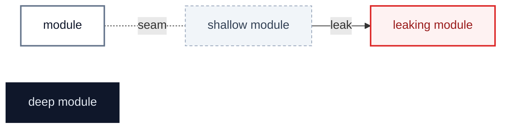
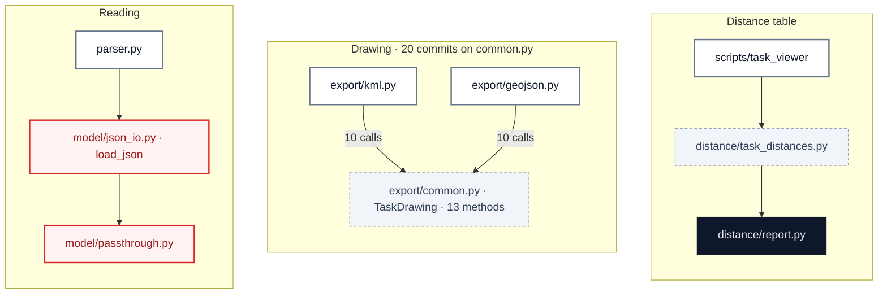

# pyxctsk: the JSON reader accepts what the writer cannot write, and the drawing asks thirteen questions where it could hand over four features

`2026-11-23` · at `12c3e50` (`main`) · scope: `src/pyxctsk/`, weighted to the 6-month churn hot spots (`distance/route_optimization.py`, `export/common.py`, `parser.py`, `distance/goal_line.py`, `model/task.py`, `qrcode/task.py`) and the co-change pairs between them · glossary: `GLOSSARY.md` · ADRs read: 0001–0004 (none bears on a candidate)

**Jump to:** [Status](#status) · [Where it hurts](#where-it-hurts) · [Since the last review](#since-the-last-review) · [Smaller findings](#smaller-findings) · [Recommendation](#recommendation) · cards: [C1](C1-json-round-trip.md) · [C2](C2-drawing-features.md) · [C3](C3-distance-table.md)

Legend

## Status

The backlog, in rank order. After the scan only three parts of the report change: this table (with the **Smaller findings** entry for each `S` row a Build phase adds), each card's **Decisions**, and **Departures**. The findings stay as found.

| ID | Candidate | Strength | Door | Lens | Status | Branch | PR | Breaking | Notes |
|---|---|---|---|---|---|---|---|---|---|
| [C1](C1-json-round-trip.md) | `load_json` reads only what `dump_json` can write | 🟢 Strong · 🔴 live defect | ↔ two-way | maintainability | pr-open | `refactor/json-round-trip` | [#53](https://github.com/simonsteiner/pyxctsk/pull/53) | no | absorbs 2026-10-02 S13, S14, S15; batch 2026-11-23: C1 → C2 → C3 → S1-S3, S5 |
| [C2](C2-drawing-features.md) | The drawing hands each writer features, not thirteen questions | 🟢 Strong | ↔ two-way | deepening | pr-open | `refactor/drawing-features` | [#54](https://github.com/simonsteiner/pyxctsk/pull/54) | yes | outputs stay byte-identical |
| [C3](C3-distance-table.md) | One way to the distance table, owned by its one consumer | 🟡 Worth exploring | ↔ two-way | deepening | pr-open | `refactor/distance-table` | [#55](https://github.com/simonsteiner/pyxctsk/pull/55) | yes | breaks the public `TaskDistanceTable` names |
| [S1](#s1--two-predicates-for-a-line-goal) | Two predicates for a line goal | - | ↔ two-way | coupling | in-progress | `refactor/smaller-findings-2026-11-23` | | | |
| [S2](#s2--three-hand-written-leg-loops) | Three hand-written leg loops | - | ↔ two-way | deepening | in-progress | `refactor/smaller-findings-2026-11-23` | | | |
| [S3](#s3--ten-type-ignores-around-the-optional-qr-imports) | Ten `type: ignore`s around the optional QR imports | - | ↔ two-way | maintainability | in-progress | `refactor/smaller-findings-2026-11-23` | | | |
| [S4](#s4--a-test-pins-a-geojson-writer-internal) | A test pins a GeoJSON writer internal | - | ↔ two-way | coupling | pr-open | rides with C2 | [#54](https://github.com/simonsteiner/pyxctsk/pull/54) | | |
| [S5](#s5--docstrings-narrate-the-codes-history) | Docstrings narrate the code's history | - | ↔ two-way | maintainability | in-progress | `refactor/smaller-findings-2026-11-23` | | | 73 lines in 26 files |
| [S6](#s6--the-hook-jobs-break-three-setup-rules) | The hook jobs break three setup rules | - | ↔ two-way | maintainability | todo | `chore/lefthook-jobs` | | | carried from 2026-10-20 S4 |
| [S7](#s7--the-compare-views-error-page-raises) | The compare view's error page raises | - | ↔ two-way | maintainability | todo | `fix/compare-view-error` | | | carried from 2026-10-20 S5 |
| [S8](#s8--a-script-imports-a-function-from-a-module-that-no-longer-has-it) | A script imports a function from a module that no longer has it | - | ↔ two-way | maintainability | todo | | | | found during C3; fails on main too |

Strength: 🟢 Strong · 🟡 Worth exploring · ⚪ Speculative · 🔴 live defect (a bug reproduced during the scan).
Door: ↔ two-way (a revert undoes it) · 🚪 one-way (a data migration, a published wire or file format, deleted user data; stops at Step 6 for the user).
Lens: `deepening` · `maintainability` · `coupling`.
Status: `todo` · `in-progress` · `pr-open` · `merged` · `blocked` · `dropped`. `blocked` and `dropped` always carry a reason in Notes.

## Where it hurts

Three inputs escape `pyXCTSKError` or write invalid JSON through `load_json` and passthrough, all reproduced from the CLI. 75% of `kml.py`'s commits and 80% of `geojson.py`'s also touch `export/common.py`. The `distance/` core (`solver.py`, `plane.py`, `measured_task.py`, `speed_section.py`, `goal_line.py`, `report.py`) and the front door (`parser.py`, `renderer.py`, `cli.py`) came back clean on all three lenses, and the layering holds.

- **No file is over the 5,000-token budget.** Watch list: `src/pyxctsk/qrcode/task.py` 4.7k (its field tables at lines 352-493 are the seam to split along), `src/pyxctsk/parser.py` 4.5k (the `Input` value and the four `FormatAdapter`s at lines 109-340).

## Since the last review

- `2026-10-20 C7, S2`: merged in [#51](https://github.com/simonsteiner/pyxctsk/pull/51); that report's table still said `pr-open` and is corrected in this PR.
- `2026-10-20 S4`: still open; carried as [S6](#s6--the-hook-jobs-break-three-setup-rules).
- `2026-10-20 S5`: still open; carried as [S7](#s7--the-compare-views-error-page-raises).
- `2026-10-02 S13, S14, S15`: still open, all three reproduced from the CLI at `12c3e50`; one fix covers them, so they became [C1](C1-json-round-trip.md).

## Smaller findings

### S1 · Two predicates for a line goal

`src/pyxctsk/distance/measured_task.py:92` · `src/pyxctsk/distance/goal_line.py:252-256` · smaller-findings PR

`task_to_turnpoints` decides a line goal with `goal.type is GoalType.LINE`, and `GoalLine._has_line_goal` with the same test plus `len(task.turnpoints) >= 2`; nothing in code ties them, and two docstrings (`measured_task.py:51-55`, `center_distance.py:118-121`) argue in prose which one owns the rule. Give the type question one home that both ask, and leave the turnpoint count as `GoalLine`'s own second question.

### S2 · Three hand-written leg loops

`src/pyxctsk/distance/center_distance.py:82-87,189-213` · `src/pyxctsk/distance/route_optimization.py:296-300` · smaller-findings PR

`_polyline` and `cumulative_center_m` each walk the same centres leg by leg, and the "last row equals the total" invariant is a docstring; the route's legs call `Geod.inv` directly instead of `earth.geodesic_distance`. One "legs along these points on this earth" function in `distance/earth.py` serves all three.

### S3 · Ten `type: ignore`s around the optional QR imports

`src/pyxctsk/qrcode/image.py:28-30,60,62,73,75,102,106,107` · smaller-findings PR

The `try/except ImportError` rebinds `qrcode`, `zxingcpp` and `Image` to `None`, and `_require_support()` checks them without narrowing, so every use carries an ignore (four hide `union-attr`). Have the check return the modules, so mypy sees them as present at each call site.

### S4 · A test pins a GeoJSON writer internal

`tests/export/test_geojson_goal_line.py:9` · rides with C2

The test imports `_create_goal_line_features`, a private function of `export/geojson.py`, so any change to how the writer is split up breaks it. Assert through `generate_task_geojson`, which C2's features make straightforward.

### S5 · Docstrings narrate the code's history

73 lines in 26 files under `src/pyxctsk/` (`grep -rEn "used to|previously|no longer|was written before"`), e.g. `model/task.py:233-241`, `qrcode/task.py:432-436`, `export/common.py:148-156` · smaller-findings PR

Paragraphs telling what the code once did change only when the code does, and the changelog and git history already hold them. Trim each to the constraint that survives (the "why"), starting with the hot modules.

### S6 · The hook jobs break three setup rules

`lefthook.yml:35-61` · own PR (carried from 2026-10-20 S4)

Every job sets `priority:` under `parallel: true`, which lefthook ignores; `mypy` runs on `{staged_files}`, though a strict type check gives a different answer on a subset; and `cspell` runs `npx --yes cspell` with no pinned version. Fix the three in the existing jobs.

### S7 · The compare view's error page raises

`scripts/task_viewer/app.py:171-175` · `scripts/task_viewer/templates/compare_view/map_script.html:12` · own PR (carried from 2026-10-20 S5)

`compare_task` renders the page with `error` but no `original_geojson`, and the map script's `{{ original_geojson | tojson | safe }}` raises on `Undefined`, so a task whose distances fail gives a 500, not the error page. Pass the GeoJSON it already loaded, or guard the include.

### S8 · A script imports a function from a module that no longer has it

`scripts/test_distance_calculations.py:34` · own PR (found during C3)

The script imports `task_to_turnpoints` from `pyxctsk.distance.task_distances`, a name that moved to `distance/measured_task.py`, so it raises `ImportError` on `main` before it runs anything. Import it from where it lives, or retire the script if nothing still runs it.

## Recommendation

> [!IMPORTANT]
> **Start with [C1 · `load_json` reads only what `dump_json` can write](C1-json-round-trip.md)**: three reproduced inputs crash the CLI or write invalid JSON, and one module owning the round trip closes all three.
>
> **Proposed batch** (every 🟢 Strong, in order, S4 inside C2): C1 → C2

## Departures

<!-- filled during implementation: where a PR deliberately differs from this report, and why -->

- **C1 · Q6:** the message for a refused JSON payload is `looks like JSON, but it was refused: <reason>`, not the old text with the reason appended. "Not a task in any format" is false for a task whose only fault is `"x":NaN`; the old text stays for JSON that decodes but matches no format.
- **C2 · Q2:** `CylinderFeature` carries a private-by-use `earth_model` field Q2 did not list, because `outline()` computes on call (Q3) and needs the task's earth.
- **C2 · Q3:** `GoalLineFeature` and `ControlZoneFeature` each carry a `goal_line` field, because `ends()` and `outline()` compute on call and ask the `GoalLine` then, not when the drawing is built.
- **C2 · Q11:** the Build ran prune-tests and deleted two duplicate tests in `tests/export/test_common.py` that the features made redundant.
- **C3 · Q10, Q11:** beyond Q11's deletions the Build deleted three tests Q10 said carry over. `test_agrees_with_optimizing_from_scratch` compared `from_task` with `from_measured_task(MeasuredTask.from_task(...))`, the same call twice, so it is gone for good. The corpus-average test is subsumed: `test_xctrack_accuracy.py` holds every reference task to 1%, which bounds the mean. `test_optimized_distance_matches_reference` was *not* covered: that file measures `optimized_distance` directly, not the report's `task_distance_m`, so the Ship phase restored it in `tests/distance/test_report_pipeline.py`.
