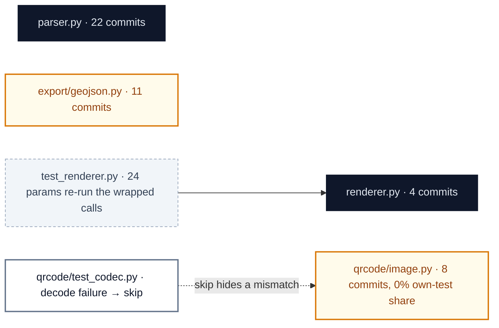

# pyxctsk: a quarter of the suite re-checks the renderer against the calls it wraps, and a skip hides the QR image round trip

`2026-11-23` · at `32571f4` (`refactor/smaller-findings-2026-11-23`, the top of the 2026-11-23 architecture-review stack) · scope: `src/pyxctsk/`, weighted by `test-history.py drift` (the test-review skill's `scripts/test-history.py`, not in this repo) over six months · glossary: `GLOSSARY.md` · ADRs read: 0001–0004 (none bears on a test)

**Jump to:** [Status](#status) · [Vitals](#vitals) · [Where it hurts](#where-it-hurts) · [Smaller findings](#smaller-findings) · [Recommendation](#recommendation) · cards: [C1](C1-renderer-tautology.md) · [C2](C2-core-only-suite.md)

## Status

The backlog, in rank order. After the scan only this table (including `S` rows Build adds, with their Smaller findings entries), any **Seams** moved at the checkpoint, the cards' **Decisions** and **After**, and **Departures** change.

| ID | Candidate | Kind | Strength | Door | Fix | Status | Branch | PR | Notes |
|---|---|---|---|---|---|---|---|---|---|
| [C1](C1-renderer-tautology.md) | Drop the renderer test that compares each row with the call it wraps | 🗑️ waste | 🟢 Strong | ↔ two-way | `prune-tests` | pr-open | `test/renderer-tautology` | [#60](https://github.com/simonsteiner/pyxctsk/pull/60) | 3.6 s of a 14.2 s suite; batch 2026-11-23: C1 → C2 → S1-S5, seams agreed as listed |
| [C2](C2-core-only-suite.md) | Run the suite once without the `qr` extra | 🔧 infra | 🟡 Worth exploring · 🔴 live defect | ↔ two-way | `direct` | pr-open | `ci/core-only-suite` | [#61](https://github.com/simonsteiner/pyxctsk/pull/61) | |
| [S1](#s1--a-qr-image-mismatch-is-reported-as-a-skip) | A QR image mismatch is reported as a skip | 🕳️ blind spot | - | ↔ two-way | `tdd` | in-progress | `test/smaller-findings-1` | | |
| [S2](#s2--the-refused-payload-wording-is-unpinned) | The refused-payload wording is unpinned | 🕳️ blind spot | - | ↔ two-way | `tdd` | in-progress | `test/smaller-findings-1` | | fix `b501266` added no test |
| [S3](#s3--geojsons-tp_type-is-never-checked-to-be-a-string) | GeoJSON's `tp_type` is never checked to be a string | 🕳️ blind spot | - | ↔ two-way | `tdd` | in-progress | `test/smaller-findings-1` | | fix `17b4615` added no test |
| [S4](#s4--three-assertions-keep-removed-names-removed) | Three assertions keep removed names removed | 🗑️ waste | - | ↔ two-way | `prune-tests` | in-progress | `test/smaller-findings-1` | | |
| [S5](#s5--a-slow-marker-nothing-uses) | A `slow` marker nothing uses | 🗑️ waste | - | ↔ two-way | `direct` | in-progress | `test/smaller-findings-1` | | |

Kind: 🕳️ blind spot (fixed with tdd) · 🗑️ waste (fixed with prune-tests) · 🔧 infra (a direct change).
Strength: 🟢 Strong · 🟡 Worth exploring · ⚪ Speculative · 🔴 live defect (a bug reproduced during the scan).
Door: ↔ two-way (a revert undoes it) · 🚪 one-way (a fixture or golden file nothing can regenerate, branch protection or required checks, a test a contract names).
Status: `todo` · `in-progress` · `pr-open` · `merged` · `blocked` · `dropped`. `blocked` and `dropped` always carry a reason in Notes.

## Vitals

| Measure | Value | From |
|---|---|---|
| Suite | 1,691 passed, 18 skipped, 14.2 s | `uv run pytest -q` |
| Slowest five | `test_speed_section::…the_ess_route_is_never_longer…` 0.90 s · `test_s7f_conformance::…every_route_point_touches_its_cylinder` 0.87 s · `…does_not_depend_on_the_projection[task_nohe]` 0.74 s · `test_elevated_goal_fixtures::…matches_seeyou_exactly` 0.66 s · `…projection[task_duna]` 0.58 s | `uv run pytest -q --durations=25` |
| One test file | 1.44 s (`tests/qrcode/test_codec.py`), 0.26 s (`tests/model/test_shape.py`) | `time uv run pytest -q <file>` |
| CI test workflow | median 59 s, 11.9 runs/week, 0 reruns (95 runs, 56 days) | `gh run list --workflow ci.yml --limit 200 --json …` |
| Fix commits without a test | 5 of 72 (6 months), 2 of them docstring-only | `test-history.py fixes src` |
| Refactor commits that changed a test | 12 test files, mostly import paths after the `distance/` split | `test-history.py refactors src` |
| Disabled tests | 0 xfail · 0 retry · 18 runtime skips, all `test_xctrack_accuracy.py:118` (concentric turnpoints); 1 skip-on-exception (S1) | `git grep -nE "pytest\.skip\|mark\.(skip\|xfail)" -- tests` |
| Coverage | not measured; SonarCloud's coverage was not readable | |

## Where it hurts

The suite is healthy: 67 of 72 fix commits added a test, no test imports a private name or mocks a module the project owns (14 `monkeypatch` sites, all the `qr` flag, corpus paths or two spies on a pinned rule), all 48 test files are collected, and a reverse-order run passes. What's left is one costly duplicate and a few unpinned edges.

- **Not worth adding:** `pytest-xdist` (14 s across 1,691 tests), a pre-push hook (CI's 59 s median covers it).
- **Already tracked elsewhere:** `scripts/test_distance_calculations.py` fails to import; it is S8 of the [2026-11-23 architecture review](../../arch-review/2026-11-23-json-and-drawing/README.md).
- **One-way door, kept:** `tests/data/reference_tasks/` holds 2.5 MB of values scraped from tools.xcontest.org that nothing regenerates; AGENTS.md already forbids hand-editing them.

## Smaller findings

### S1 · A QR image mismatch is reported as a skip

`tests/qrcode/test_codec.py:158-169` · smaller-findings PR

The `try` around the image round trip holds both `assert`s, so `except Exception: pytest.skip(...)` turns a payload that comes back different into a skip across all 24 corpus tasks. Keep the skip for a missing extra only and let the assertions fail, so a change to `qrcode/image.py` (8 commits, no own-test share) that corrupts a payload fails CI.

### S2 · The refused-payload wording is unpinned

`src/pyxctsk/parser.py:363` · smaller-findings PR

Fix `b501266` made a valid JSON task refused for one value say `looks like JSON, but it was refused: <reason>` instead of "not a task in any format", and no test matches `was refused`. Pin it at `parse_task` with the `"x": NaN` task.

### S3 · GeoJSON's `tp_type` is never checked to be a string

`src/pyxctsk/export/geojson.py:39` · `tests/export/test_geojson.py:153` · smaller-findings PR

Fix `17b4615` wrote `.value` instead of the `TurnpointType` member, but the test only checks the key exists, and the serialized bytes are the same either way because the enum subclasses `str`. Assert `type(props["tp_type"]) is str` on `generate_task_geojson`'s dict.

### S4 · Three assertions keep removed names removed

`tests/test_renderer.py:75-76` · `tests/qrcode/test_conversion.py:237` · smaller-findings PR

`not hasattr(pyxctsk, "EXTENSION")`, `"MIME_TYPE"` and `"VERSION"` depend on the past: they guard no current behaviour, and the assertions beside them (`OUTPUT_FORMATS["json"].extension`, the `FULL_FORMAT_VERSION` identity) carry the rule. Delete the three lines, keep their neighbours.

### S5 · A `slow` marker nothing uses

`pyproject.toml:158-160` · smaller-findings PR

`markers = ["slow: …"]` is declared and `git grep "mark.slow" -- tests` finds nothing, so `-m "not slow"` deselects nothing. At 14 s there is no slow tier to mark; remove the declaration.

## Recommendation

> [!IMPORTANT]
> **Start with [C1 · Drop the renderer test that compares each row with the call it wraps](C1-renderer-tautology.md)**: it is a quarter of every run, and of what it guards only the row-to-writer wiring needs keeping, which one task does.
>
> **Proposed batch** (every 🟢 Strong, in order, then one PR for S1–S5): C1 → S1–S5

## Departures

<!-- filled during implementation: where a PR deliberately differs from this report, and why -->

- **C1 · review:** the test is rewritten at one task, not deleted outright: the PR #60 review showed it was the only guard on which writer the `kml` and `geojson` rows call, so `test_each_map_row_calls_its_own_writer` keeps that on `task_bevo` (#58 corrects the card).
- **C1:** the cut was made by hand, not through `prune-tests`: the card named one test, so there was nothing for the skill to choose. The Ship review was a read of the 33-line diff against the card rather than `review-prs`. The test class kept two tests and is renamed `TestTheOptionsAndTheReadBack`, since "what they always were" no longer describes them.
- **C2 · Q4:** the core-only run is on all four CI legs, not one Python version: the legs run in parallel, so one or four costs the same wall time, and picking one would need a `ci.yml` change or a version hard-coded into `verify.sh`. The scan said the suite's behaviour without the extra was unknown; the Design phase found five tests that need the extra and had no skip, so C2 became a live defect.
- **C2 · Q2:** the core-only run removes the extra with `uv pip uninstall pillow qrcode zxing-cpp` and runs with `uv run --frozen --no-sync --no-build`, not `uv sync --frozen`. SonarCloud failed #61's quality gate on rule S8541 (a `uv` command without `--no-build` may run build scripts), and `uv sync --frozen --no-build` can't install `simplekml`, which ships only an sdist; after the uninstall nothing is installed or built. Same counts: 1,617 passed, 65 skipped; `verify.sh` 29.5 s.
